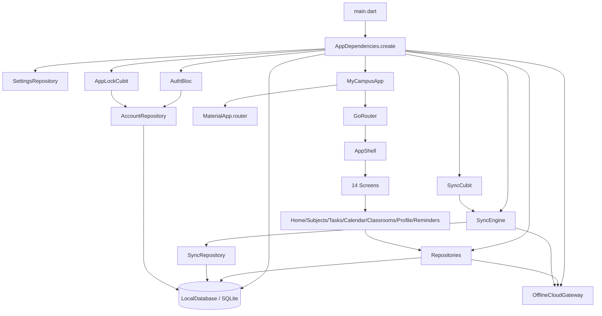
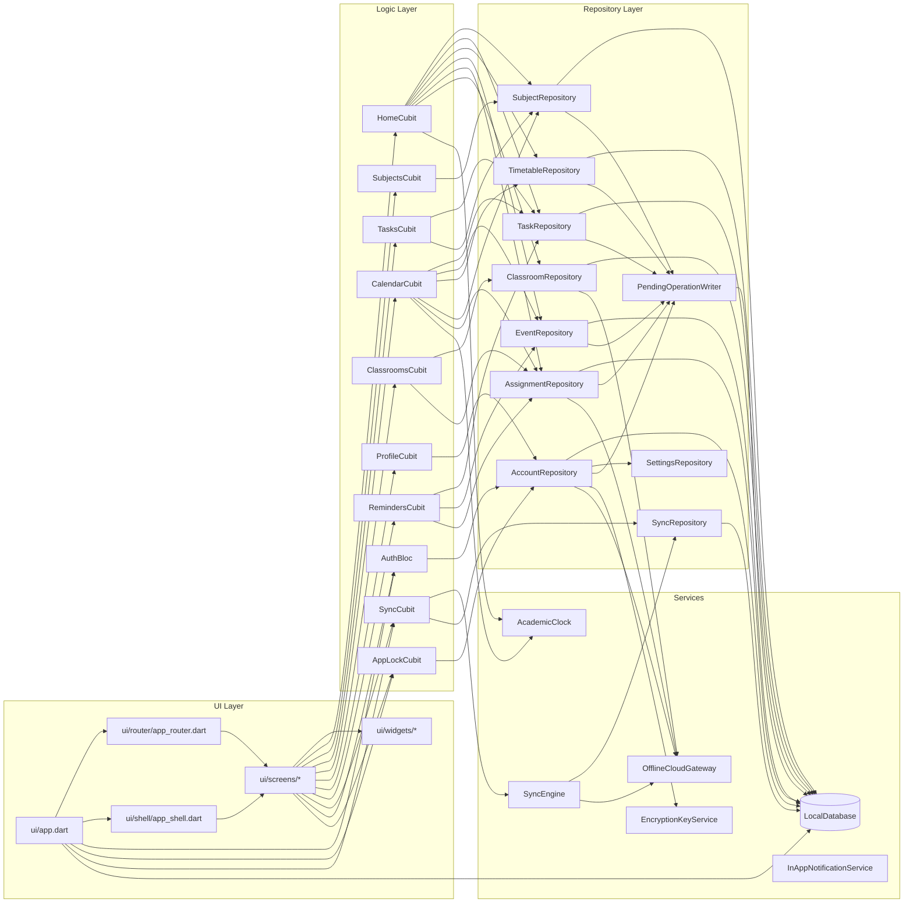
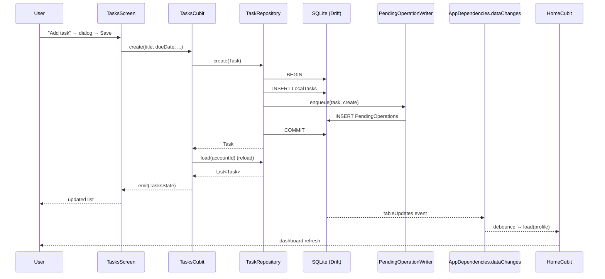
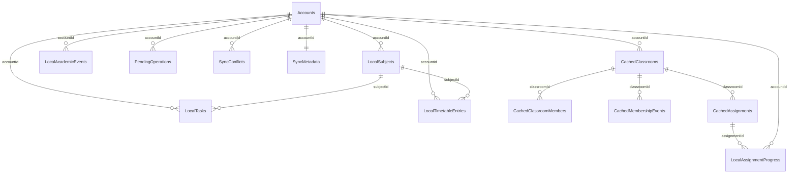
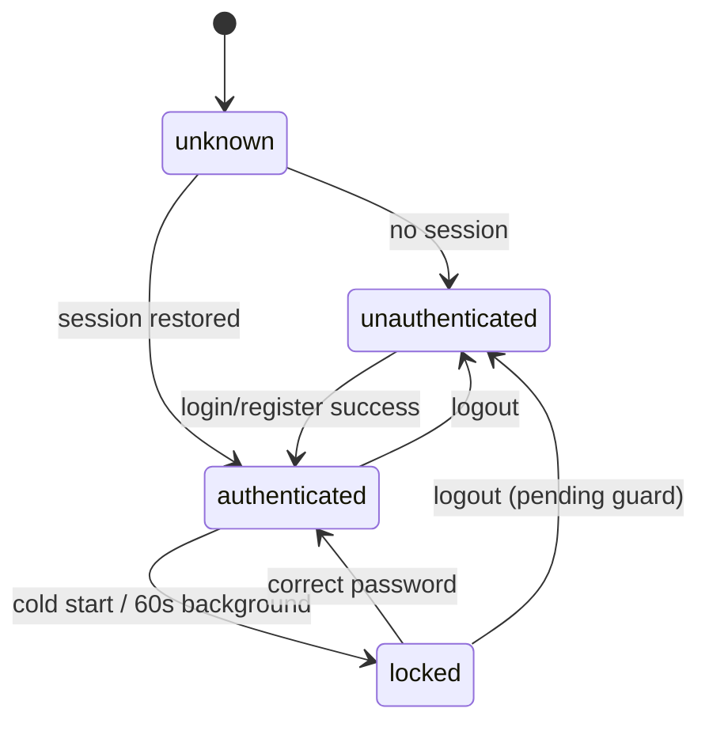

# MyCampus — ကုဒ်ဘေ့စ် အပြည့်အစုံ နည်းပညာစာတမ်း (မြန်မာ)

> **စာတမ်းအမည်:** MyCampus_Full_Codebase_Documentation_MM.md
> **ပရောဂျက်:** `C:\hsu\mycampus` — MyCampus Flutter application
> **စစ်ဆေးသည့်ရက်စွဲ:** 2026-11-12
> **စစ်ဆေးသည့်နည်းလမ်း:** ဖိုင်အားလုံးကို တိုက်ရိုက်ဖတ်ခြင်း၊ `flutter analyze` နှင့် `flutter test` အမှန်တကယ် run ခြင်း
> **အရေးကြီး:** ဤစာတမ်းပြုစုမှုအတွင်း မူရင်း source code မည်သည့်ဖိုင်ကိုမျှ မွမ်းမံ၊ ဖျက်၊ ပြင်ဆင်၊ အစားထိုး မပြုလုပ်ခဲ့ပါ။

---

## 0. စာတမ်းဖတ်ရှုပုံလမ်းညွှန် (Table of Contents)

1. ပရောဂျက် အကျဉ်းချုပ်
2. နည်းပညာ Stack နှင့် Dependency များ
3. ပရောဂျက် Directory ဖွဲ့စည်းပုံ
4. Architecture အကျဉ်းချုပ် (Diagram များ)
5. ဖိုင်တစ်ဖိုင်ချင်း ရှင်းလင်းချက်
   - 5.1 Root configuration နှင့် tests
   - 5.2 `lib/constants/`
   - 5.3 `lib/models/`
   - 5.4 `lib/services/`
   - 5.5 `lib/repositories/`
   - 5.6 `lib/logic/` (BLoC/Cubit)
   - 5.7 `lib/ui/` app, router, shell, theme, widgets
   - 5.8 `lib/ui/screens/`
   - 5.9 Platform configuration (Android/Windows/Web)
6. ဖိုင်-to-ဖိုင် ဆက်စပ်မှု မြေပုံ (Dependency Map)
7. Database Architecture (Drift/SQLite)
8. BLoC/Cubit Architecture
9. Application Flow များ (အစမှ အဆုံး)
10. UI နှင့် Navigation Inventory
11. Authentication Architecture
12. Student နှင့် Teacher Feature ကွဲပြားမှု
13. Implemented vs Incomplete Matrix
14. ပြဿနာများ၊ အန္တရာယ်များ နှင့် အားနည်းချက်များ
15. Supabase/API အနာဂတ် ချိတ်ဆက်ရေး လမ်းညွှန်
16. Developer အတွက် ပြင်ဆင်ရမည့်နေရာ လမ်းညွှန်
17. စစ်ဆေးအတည်ပြုချက် နှင့် နောက်ဆုံးအခြေအနေ
18. နောက်ဆက်တွဲများ

---

## 1. ပရောဂျက် အကျဉ်းချုပ်

**MyCampus** သည် ကျောင်းသား/ဆရာ နှစ်ဦးစလုံးအတွက် ရည်ရွယ်ထားသော **offline-first academic planner နှင့် classroom companion** Flutter application ဖြစ်သည်။ လက်ရှိ build သည် backend မလိုဘဲ device ပေါ်တွင် အပြည့်အဝ အလုပ်လုပ်နိုင်ရန် ဒီဇိုင်းဆွဲထားပြီး Supabase အတွက် interface များကို ကြိုတင်ချိတ်ဆက်ထားသည်။ သို့သော် အမှန်တကယ် cloud backend သည် **မချိတ်ဆက်ရသေးပါ**။

| အချက် | အခြေအနေ |
|---|---|
| Framework | Flutter (Dart SDK `^3.13.5`) |
| လက်ရှိ run နိုင်သည့် platform | Android (emulator/device), Windows (build toolchain ရှိပါက) |
| Web | **မရနိုင်** — `local_database.dart` က `dart:io` နှင့် `drift/native` ကို တိုက်ရိုက် import ထားသည် |
| Local storage | Drift + SQLite (`mycampus_local.sqlite`) |
| State management | `flutter_bloc` — Cubit ၁၀ ခု + Bloc ၁ ခု (`AuthBloc`) |
| Navigation | `go_router` — StatefulShellRoute (5 branch) |
| Cloud | `supabase_flutter` dependency ပါသော်လည်း runtime တွင် `OfflineCloudGateway` သာ အသုံးပြုသည် |
| Auth | Device-local salted SHA-256 (prototype)၊ Supabase Auth မဟုတ်သေး |
| Encryption | abstraction သာ ရှိသည်၊ SQLite ဖိုင်ကို အမှန်တကယ် encrypt မလုပ်ပါ |
| Notifications | in-app Reminder Center သာ၊ native notification မရှိ |
| Tests | 15 tests အားလုံး pass (`flutter test`) |
| Analyzer | `No issues found!` (`flutter analyze`, 110s) |

### 1.1 ဤစာတမ်းတွင် သတိပြုရမည့် အခြေခံမူ

- ဖိုင် သို့မဟုတ် function ရှိတိုင်း feature အလုပ်လုပ်သည်ဟု **မယူဆ**ပါ။ ခေါ်သုံးမှု (call site) ရှိ/မရှိကို စစ်ဆေးပြီးမှ အတည်ပြုထားသည်။
- ဤစာတမ်းပါ line number များသည် စစ်ဆေးချိန်ရှိ ဖိုင်အခြေအနေအတိုင်း ဖြစ်သည်။
- "verified" ဟု မှတ်ထားသည့်အချက်များကို ဖိုင်ဖတ်ခြင်း၊ grep/ripgrep ဖြင့် import/call site ရှာခြင်းဖြင့် အတည်ပြုထားသည်။
- App ကို emulator ပေါ်တွင် အပြည့်အစုံ regression test ပြုလုပ်ထားသည်ဟု ဤစာတမ်းတွင် **မဆိုပါ**။ `flutter analyze` နှင့် `flutter test` ကိုသာ အမှန်တကယ် run ထားသည်။

---

## 2. နည်းပညာ Stack နှင့် Dependency များ

### 2.1 `pubspec.yaml` (112 lines)

| ကဏ္ဍ | တန်ဖိုး | မှတ်ချက် |
|---|---|---|
| `name` | `project1` (L1) | အမည်မှာ MyCampus မဟုတ်၊ template အမည် ကျန်နေသည် |
| `description` | "A new Flutter project." (L2) | placeholder |
| `version` | `1.0.0+1` (L19) | |
| `environment.sdk` | `^3.13.5` (L22) | |
| `cupertino_icons` | `^1.0.8` (L36) | |
| `flutter_bloc` | `^9.1.1` (L37) | |
| `bloc` | `^9.2.1` (L38) | |
| `http` | constraint မရှိ (L39) | **`lib/` တွင် import 0 ခု — အသုံးမပြု** |
| `equatable` | `^3.0.0` (L40) | |
| `supabase_flutter` | `^2.18.3` (L41) | client ကို initialize လုပ်နိုင်သော်လည်း gateway မှ မသုံး |
| `drift` | `^2.35.4` (L42) | |
| `sqlite3_flutter_libs` | `^0.6.0+eol` (L43) | EOL tag ပါသည် |
| `path_provider` | `^2.1.6` (L44) | |
| `path` | `^1.9.1` (L45) | |
| `uuid` | `^4.6.0` (L46) | `IdService` မှ အသုံးပြု |
| `go_router` | `^18.1.4` (L47) | |
| `intl` | `^0.20.3` (L48) | |
| `crypto` | `^3.0.8` (L49) | SHA-256 |
| `timezone` | `^0.11.2` (L50) | |
| dev: `flutter_lints` | `^6.0.0` (L62) | |
| dev: `drift_dev` | `^2.35.3` (L63) | |
| dev: `build_runner` | `^2.17.1` (L64) | |

**Assets (L79–83):** `asset/image/campus.jpg`, `student.jpg`, `teacher.jpg`, `both.jpg`။
`both.jpg` ကို declare လုပ်ထားသော်လည်း `lib/` မှ မည်သည့်နေရာမှ မခေါ်သုံးပါ။ `asset/image/` ထဲတွင် ရှိသော `beauty.jpg`, `electronics.jpg`, `fashion.jpg`, `home_living.jpg`, `p1.jpg`, `sports.jpg`, `study.jpg`, `toys.jpg` တို့ကို declare မလုပ်ထားပါ။

### 2.2 ခေါ်သုံးမှု အနေအထား (verified)

| Package | `lib/` အတွင်း အသုံးပြုမှု |
|---|---|
| `flutter_bloc` / `bloc` | ဟုတ်သည် |
| `drift` | ဟုတ်သည် |
| `go_router` | ဟုတ်သည် |
| `equatable` | ဟုတ်သည် |
| `intl` | ဟုတ်သည် |
| `timezone` | `academic_clock.dart` |
| `crypto` | `id_service.dart` (hash) |
| `uuid` | `id_service.dart` |
| `path_provider`, `path` | `local_database.dart` |
| `supabase_flutter` | `supabase_service.dart` သာ |
| `http` | **0 imports** |
| `sqlite3_flutter_libs` | native SQLite runtime အတွက် transitively လိုအပ် |

### 2.3 Dio / Interceptor မရှိကြောင်း ရှင်းလင်းချက်

ဤပရောဂျက်တွင် **Dio မရှိပါ**၊ **HTTP interceptor မရှိပါ**။ Networking အတွက် ရည်ရွယ်ထားသည့် abstraction မှာ `lib/services/cloud_gateway.dart` ဖြစ်ပြီး လက်ရှိ binding မှာ `OfflineCloudGateway` ဖြစ်သည်။ `supabase_flutter` ကို dependency အဖြစ် ထည့်ထားသော်လည်း `OfflineCloudGateway` ကို အစားထိုးသည့် concrete implementation မရှိသေးပါ။ ထို့ကြောင့် "Dio interceptor ဖြင့် auth token ထည့်သည်" ဆိုသည့် အချက်သည် ဤကုဒ်တွင် **လုံးဝ မမှန်ပါ**။

---

## 3. ပရောဂျက် Directory ဖွဲ့စည်းပုံ

```
C:\hsu\mycampus\
├─ lib\                          # hand-written Dart 71 ဖိုင်
│  ├─ main.dart
│  ├─ constants\                 # 5 ဖိုင်
│  ├─ models\                    # 12 ဖိုင်
│  ├─ services\                  # 10 ဖိုင် + local_database.g.dart (generated)
│  ├─ repositories\              # 10 ဖိုင်
│  ├─ logic\                     # 11 ဖိုင် (Cubit/Bloc)
│  └─ ui\
│     ├─ app.dart
│     ├─ router\app_router.dart
│     ├─ shell\app_shell.dart
│     ├─ theme\app_theme.dart
│     ├─ widgets\                # common, pickers, tab_header
│     └─ screens\                # 14 ဖိုင် (auth 5, lock 1, home 1,
│                                # subjects 1, tasks 1, calendar 1,
│                                # classrooms 2, profile 1, reminders 1, sync 1)
├─ test\                         # 2 ဖိုင်
│  ├─ asset_images_test.dart
│  └─ responsive_layout_test.dart
├─ asset\image\                  # ပုံများ (အချို့ declare မထားပါ)
├─ android\                      # Android config + MainActivity.kt
├─ windows\                      # Windows runner
├─ web\                          # web shell (သုံး၍မရ)
├─ ios\, macos\, linux\          # generated platform folders
├─ pubspec.yaml, pubspec.lock
├─ analysis_options.yaml
├─ README.md
├─ supabase_config.json          # ကုဒ်မှ မဖတ်ပါ
├─ .gitignore, .metadata
└─ flutter_01.png                # 0 bytes
```

**ကုဒ်ပမာဏ:** hand-written Dart ဖိုင် ၇၁ ဖိုင်၊ စုစုပေါင်း ≈ 15,000 lines။ `lib/services/local_database.g.dart` သည် 469,989 bytes / ≈14,370 lines ရှိပြီး **Drift generated** ဖြစ်သည်။ ထိုဖိုင်ကို လက်ဖြင့် ပြင်ရန် မဟုတ်ပါ။

---

## 4. Architecture အကျဉ်းချုပ်

### 4.1 အလွှာအလိုက် ဖွဲ့စည်းပုံ (ASCII)

```
┌────────────────────────────────────────────────────────────┐
│ UI Layer (lib/ui)                                          │
│  screens → widgets → context.read/watch<Cubit/Bloc>        │
└──────────────────────────┬─────────────────────────────────┘
                           │ methods / state stream
┌──────────────────────────▼─────────────────────────────────┐
│ Presentation Logic (lib/logic)                             │
│  AuthBloc, AppLockCubit, HomeCubit, SubjectsCubit,         │
│  TasksCubit, CalendarCubit, ClassroomsCubit,               │
│  ProfileCubit, RemindersCubit, SyncCubit                   │
└──────────────────────────┬─────────────────────────────────┘
                           │ repository calls
┌──────────────────────────▼─────────────────────────────────┐
│ Repository Layer (lib/repositories)                        │
│  Account, Subject, Task, Timetable, Event, Assignment,     │
│  Classroom, Sync, Settings, PendingOperationWriter         │
└──────────────┬───────────────────────────┬─────────────────┘
               │ Drift queries              │ CloudGateway
┌──────────────▼─────────────┐   ┌─────────▼─────────────────┐
│ Drift / SQLite (local)     │   │ OfflineCloudGateway       │
│ local_database.dart        │   │ (isConfigured == false)   │
│ 15 tables                  │   │ SupabaseService (unused)  │
└────────────────────────────┘   └───────────────────────────┘
```

### 4.2 Runtime Object Graph (Mermaid)



### 4.3 အဓိက ဒီဇိုင်းဆုံးဖြတ်ချက်များ

1. **Local-first:** UI သည် ပထမဆုံး local DB ကို ဖတ်/ရေးသည်။ Cloud မလိုအပ်သော feature များ (subjects, tasks, calendar, reminders, profile) သည် အပြည့်အဝ အလုပ်လုပ်သည်။
2. **Atomic outbox:** ဒေတာပြောင်းလဲမှုတိုင်း record နှင့် `PendingOperations` ကို transaction တစ်ခုတည်းတွင် ရေးသည် (`PendingOperationWriter`)။
3. **Cloud abstraction:** `CloudGateway` interface ကို နောက်ပိုင်း Supabase implementation ဖြင့် အစားထိုးနိုင်ရန် ရည်ရွယ်ထားသည်။
4. **Role-aware shell:** Teacher နှင့် Student အတွက် tab များ မတူပါ။
5. **Session lock:** Cold start နှင့် background 60s ကျော်ပါက password ပြန်ထည့်ရသည်။

---

## 5. ဖိုင်တစ်ဖိုင်ချင်း ရှင်းလင်းချက်

> ဖော်မတ် — **Path** / တာဝန် / အဓိက symbol များ (line) / import / အသုံးပြုသူ / data အဝင်-အထွက် / DB / အခြေအနေ။

### 5.1 Root configuration နှင့် tests

#### 5.1.1 `pubspec.yaml`

- **တာဝန်:** Flutter package manifest၊ dependency နှင့် asset ကြေညာချက်။
- **အဓိက:** dependencies L30–50၊ dev_dependencies L53–64၊ assets L79–83။
- **အခြေအနေ:** **partial** — package name `project1`၊ description placeholder၊ `http` မသုံး၊ `both.jpg` မသုံး၊ image ၈ ပုံ declare မထား။
- **ဆက်စပ်:** ဖိုင်အားလုံး၏ package import `package:project1/...` ကို ဆုံးဖြတ်သည်။

#### 5.1.2 `analysis_options.yaml` (1,585 bytes)

- **တာဝန်:** lint rule များ။
- **အခြေအနေ:** **complete** သို့သော် generated `local_database.g.dart` ကို exclude မလုပ်ထားပါ (L13–20)။ Analyzer က generated code ကို စစ်နေသည်။
- **အကြံပြုချက်:** `analyzer.exclude` တွင် `lib/**/*.g.dart` ထည့်ရန်။ (ကုဒ်မပြင်ရန် ညွှန်ကြားထားသဖြင့် ဤစာတမ်းတွင် မပြင်ပါ။)

#### 5.1.3 `README.md` (115 lines)

- **တာဝန်:** ပရောဂျက် ဖော်ပြချက်၊ feature coverage ဇယား၊ deviation မှတ်စုများ (TV-01…TV-09)။
- **အဓိက ကွဲလွဲမှု:** L5–6 တွင် "runs entirely on a local **encrypted-at-rest** database" ဟု ဆိုထားသော်လည်း L95 (TV-01) တွင် database ကို encrypt မလုပ်ရသေးဟု ဖော်ပြထားသည်။ ဤစာတမ်းက **encrypt မလုပ်ထားကြောင်း** ကို အတည်ပြုသည်။
- **အခြေအနေ:** **partial** — လက်ရှိကုဒ်နှင့် ကိုက်ညီမှုမရှိသည့် ကြေညာချက်များ ရှိသည်။

#### 5.1.4 `.gitignore` (970 bytes)

- **တာဝန်:** build artifact, `.dart_tool`, IDE file များ ဖယ်ရှားရန်။
- **အခြေအနေ:** **complete** for a Flutter template။ `supabase_config.json` ကို ignore မလုပ်ထားပါ (လုံခြုံရေး အန္တရာယ်)။

#### 5.1.5 `supabase_config.json` (131 bytes)

- **အကြောင်းအရာ:** `http://10.10.50.111:4000` နှင့် publishable key တစ်ခု။
- **အသုံးပြုမှု:** **ကုဒ်မှ လုံးဝ မဖတ်ပါ** (0 references)။ Runtime သည် `String.fromEnvironment('SUPABASE_URL')` နှင့် `SUPABASE_PUBLISHABLE_KEY` ကိုသာ ဖတ်သည်။
- **အခြေအနေ:** **unused / security risk** — plain HTTP URL နှင့် key ကို repository ထဲ commit လုပ်ထားသည်။
- **အန္တရာယ်:** ဤ key ကို လက်ရှိ backend တွင် အသုံးပြုနေပါက rotate လုပ်ရန်။

#### 5.1.6 `.metadata` (964 bytes)

- **တာဝန်:** Flutter tool မှ platform folder များ၏ revision ကို မှတ်ထားသည်။
- **အခြေအနေ:** **generated/complete**။ လက်ဖြင့် မပြင်ရ။

#### 5.1.7 `test/asset_images_test.dart` (22 lines)

- **တာဝန်:** `campus.jpg`, `student.jpg`, `teacher.jpg` ကို `rootBundle.load` ဖြင့် ဖွင့်နိုင်ကြောင်း စစ်သည် (L9–21)။
- **DB:** မရှိ။ **Data:** asset bytes။
- **အခြေအနေ:** **complete** (test pass)။ သို့သော် `both.jpg`, `flutter_01.png` နှင့် undeclared image များကို မစစ်ပါ။

#### 5.1.8 `test/responsive_layout_test.dart` (220 lines)

- **တာဝန်:** 320, 360, 390, 430, 600, 768, 1024, 1366, 1920 px အကျယ်များတွင် representative `AppPage` layout မည်သည့် overflow မှ မဖြစ်ကြောင်း စစ်သည် (L7, L29+)။ Dialog body width ကို viewport ထက် မကျော်ကြောင်းလည်း စစ်သည်။
- **အခြေအနေ:** **complete** (15 tests pass)။ သို့သော် တကယ့် screen တစ်ခုချင်းစီကို မ run ပါ၊ representative widget ကိုသာ စစ်သည်။

---

### 5.2 `lib/constants/`

#### 5.2.1 `lib/constants/api_endpoints.dart` (46 lines)

- **တာဝန်:** Supabase REST/RPC endpoint path များ သတ်မှတ်ရန် ရည်ရွယ်ထားသည်။
- **အဓိက:** `ApiEndpoints` (L5)။
- **အသုံးပြုသူ:** **0 importers** — dead file။
- **အခြေအနေ:** **unused / placeholder**။
- **အန္တရာယ်:** endpoint များကို ဤဖိုင်တွင် ထည့်ထားပြီး အမှန်တကယ် မချိတ်ဆက်ရသေးသဖြင့် ဖတ်သူက "ချိတ်ဆက်ပြီး" ဟု မှားနိုင်သည်။

#### 5.2.2 `lib/constants/app_colors.dart` (55 lines)

- **တာဝန်:** အပြာ/အဖြူ အရောင်စနစ် (approved blue/white visual language)။
- **အဓိက:** `AppColors` (L9) — `primary`, `primaryBlue`, `navy`, `background`, `border`, `textSecondary`, `dangerSoft`, `infoSoft`, `skySoft`, `navInactive` စသည်။
- **အသုံးပြုသူ:** UI ဖိုင်အားလုံးနီးပါး။
- **အခြေအနေ:** **complete**။ SRS ၏ purple token ကို app theme အဖြစ် မသုံးပါ၊ subject default colour အဖြစ်သာ ကျန်သည်။

#### 5.2.3 `lib/constants/app_constants.dart` (27 lines)

- **တာဝန်:** app name, tagline, timezone, lock threshold, local-mode notice, weekday labels, time formats။
- **အဓိက:** `appName` L3, `defaultAcademicTimezone` L7, `backgroundLockThreshold` L10, `localModeNotice` L13–16, `weekdayLabels` L18–24, `timeFormats` L26။
- **အသုံးပြုသူ:** `defaultAcademicTimezone` ကို `account_repository.dart:94` နှင့် `academic_clock.dart:31,37` တွင် သုံးသည်။ ကျန် constant များ (`appName`, `appTagline`, `backgroundLockThreshold`, `localModeNotice`, `weekdayLabels`, `timeFormats`) ကို **မည်သည့်နေရာမှ မခေါ်သုံးပါ** (grep 0 hits)။ `backgroundLockThreshold` အစား `AppLockCubit` က 60s ကို `app_lock_cubit.dart:53` တွင် hardcode လုပ်ထားသည်။ `appName` အစား `app.dart:124` တွင် literal `'MyCampus'` ရေးထားသည်။
- **အခြေအနေ:** **partial / mostly unused**။

#### 5.2.4 `lib/constants/app_images.dart` (18 lines)

- **တာဝန်:** asset image path နှင့် role အလိုက် ပုံရွေးချယ်မှု။
- **အဓိက:** `campus` L6, `student` L7, `teacher` L8, `both` L9, `forRole` L12, `forRoleCode` L16။
- **အသုံးပြုသူ:** welcome, role selection, register, home, lock, profile။
- **အခြေအနေ:** **partial** — `both` ကို မခေါ်သုံးပါ။

#### 5.2.5 `lib/constants/app_spacing.dart` (15 lines)

- **တာဝန်:** spacing နှင့် radius token များ။
- **အဓိက:** `xs`…`xxl` L2–7, `pagePadding` L9, `cardRadius` L10, `fieldRadius` L11, `minTouchTarget` L14။
- **အသုံးပြုသူ (verified):** `cardRadius` — `common.dart:34,485`, `login_screen.dart:55`, `welcome_screen.dart:359`, `calendar_screen.dart:1154,1460`, `classrooms_screen.dart:439,537`, `classroom_detail_screen.dart:298,1252`, `profile_screen.dart:237,305,398,521`, `tasks_screen.dart:740`။ `fieldRadius` — `app_shell.dart:277`, `app_theme.dart:23,72,83`။ `minTouchTarget` — `lock_screen.dart:474`, `app_theme.dart:67,78`။ `xs/sm/md/lg/xl/xxl/pagePadding` ကို **မသုံးပါ**။
- **အခြေအနေ:** **partially used**။

---

### 5.3 `lib/models/`

#### 5.3.1 `lib/models/enums.dart` (210 lines)

- **တာဝန်:** စနစ်တစ်ခုလုံး၏ code/label enum များ။ DB တွင် `.code` string အဖြစ် သိမ်းသည်။
- **အဓိက:**
  - `UserRole` L1 — student/teacher၊ `fromCode` L10 (မသိရင် student သို့ fallback)။
  - `TaskPriority` L18 — low/medium/high၊ fallback medium L31။
  - `TaskStatus` L36 — pending/completed၊ fallback pending။
  - `AcademicEventType` L53 — exam/meeting/seminar/study_session/other။
  - `MembershipStatus` L73 — active/left/removed၊ fallback **left**။
  - `MembershipEventType` L91 — joined/left/removed/unblocked။
  - `AssignmentStatus` L110 — draft/published/archived။
  - `SyncStatus` L129 — synced/pending/sending/failed/conflict။
  - `SyncOperationType` L149 — create/update/delete။
  - `SyncEntity` L167 — profile/subject/task/timetable_entry/academic_event/assignment_progress။
  - `ReminderBucket` L188 — dueSoon/overdue/upcoming။
  - `TimeFormat` L198 — twelveHour('12')/twentyFourHour('24')။
- **အသုံးပြုသူ:** models, repositories, cubits, UI အားလုံး။
- **အခြေအနေ:** **complete**။
- **အန္တရာယ်:** `UserRole.fromCode` က မမှန်သော role ကို student အဖြစ် တိတ်ဆိတ်စွာ ပြောင်းသည်။ Authorization error မဟုတ်ဘဲ data မှားနိုင်သည်။

#### 5.3.2 `lib/models/user_profile.dart` (67 lines)

- **တာဝန်:** လက်ရှိ session ၏ user data။
- **အဓိက:** fields L16–24 (`id`, `fullName`, `email`, `role`, `academicTimezone`, `timeFormat`, `emailVerified`, `createdAt`, `updatedAt`)၊ `copyWith` L26–44၊ `toJson` L46–54၊ `fromJson` L56–66။
- **DB:** `Accounts` နှင့် map လုပ်သည် (repository မှတဆင့်)။
- **အခြေအနေ:** **complete**။ `copyWith` တွင် `email`/`role`/`id` ကို ပြောင်းခွင့်မရှိ — မှန်ကန်သည်။

#### 5.3.3 `lib/models/subject.dart` (86 lines)

- **တာဝန်:** ဘာသာရပ် entity။
- **အဓိက:** ctor L4–16၊ fields L18–30၊ `isDeleted` L32၊ `copyWith` L34–58၊ `toJson` L60–70၊ `fromJson` L72–85။ default colour `0xFF6236F5` L9 (SRS purple)။
- **DB:** `LocalSubjects` ↔ `SubjectRepository`။
- **အခြေအနေ:** **complete**။ `toJson` တွင် `account_id` မပါပါ (repository က ထပ်ဖြည့်သည်)။

#### 5.3.4 `lib/models/task.dart` (130 lines)

- **တာဝန်:** ကိုယ်ပိုင် task/deadline။
- **အဓိက:** ctor L6–23၊ fields L25–46၊ `isCompleted` L48၊ `isDeleted` L49၊ `copyWith` L51–92 (clear flag များပါ)၊ `toJson` L94–109၊ `fromJson` L111–129။
- **DB:** `LocalTasks` ↔ `TaskRepository`။ dueDate ကို `yyyy-MM-dd` wall-clock string အဖြစ် သိမ်းသည်။
- **အခြေအနေ:** **complete**။

#### 5.3.5 `lib/models/timetable_entry.dart` (96 lines)

- **တာဝန်:** အပတ်စဉ် Monday–Friday timetable entry။
- **အဓိက:** ctor L5–17၊ fields L19–33၊ `duration` L36၊ `overlaps` L38+၊ `copyWith`/`toJson`/`fromJson` ပါ။
- **DB:** `LocalTimetableEntries` ↔ `TimetableRepository`။
- **အခြေအနေ:** **complete**။

#### 5.3.6 `lib/models/academic_event.dart` (111 lines)

- **တာဝန်:** ကိုယ်ပိုင် calendar event။
- **အဓိက:** ctor L4–19၊ fields L21–38၊ `isDeleted` L40၊ `copyWith` L42–77၊ `toJson` L79–92၊ `fromJson` L94–110။
- **DB:** `LocalAcademicEvents` ↔ `EventRepository`။
- **အခြေအနေ:** **complete**။

#### 5.3.7 `lib/models/assignment.dart` (112 lines)

- **တာဝန်:** Classroom assignment နှင့် progress။
- **အဓိက:** `Assignment` L3 — fields L20–34၊ `isDeleted` L36၊ `isVisibleToStudents` L37–38၊ `copyWith` L40+၊ `toJson`/`fromJson`။ `AssignmentProgress` L72။
- **DB:** `CachedAssignments`, `LocalAssignmentProgress` ↔ `AssignmentRepository`။
- **အခြေအနေ:** **complete**။ `classroomName` သည် cache-only field ဖြစ်သည်။

#### 5.3.8 `lib/models/classroom.dart` (52 lines)

- **တာဝန်:** Classroom header data။
- **အဓိက:** ctor L2–13၊ fields L15–28၊ `copyWith` L30–51။ timezone ကို immutable ထားသည်။
- **DB:** `CachedClassrooms` ↔ `ClassroomRepository`။
- **အခြေအနေ:** **complete**။

#### 5.3.9 `lib/models/classroom_member.dart` (65 lines)

- **တာဝန်:** Membership နှင့် membership event။
- **အဓိက:** `ClassroomMember` L3 — fields L16–24၊ `isActive` L26၊ `copyWith` L28–44။ `MembershipEvent` L47 — fields L58–64။
- **DB:** `CachedClassroomMembers`, `CachedMembershipEvents`။
- **အခြေအနေ:** **complete**။ `studentEmail` ကို student UI တွင် ပြသမှုသည် ကိုယ်ရေးကိုယ်တာ အန္တရာယ် (အပိုင်း 14)။

#### 5.3.10 `lib/models/dashboard_data.dart` (59 lines)

- **တာဝန်:** Home dashboard အတွက် aggregate data နှင့် calendar day item။
- **အဓိက:** `TodayScheduleItem` L9၊ `DashboardData` L18 — fields L29–35၊ `isEmpty` L37–41။ `CalendarDayItems` L46 — tasks/events/assignments၊ `isEmpty` L57၊ `total` L58။
- **အသုံးပြုသူ:** `HomeCubit`, `CalendarCubit`, `home_screen.dart`, `calendar_screen.dart`။
- **အခြေအနေ:** **complete**။

#### 5.3.11 `lib/models/reminder_item.dart` (33 lines)

- **တာဝန်:** task/event/assignment များကို Reminder Center အတွက် unified item အဖြစ် ပြောင်းသည်။
- **အဓိက:** ctor L6–16၊ fields L18–30၊ `isOverdue` L32။ `source` သည် `'task' | 'event' | 'assignment'` (L26–27)။
- **အသုံးပြုသူ:** `ReminderBuilder`, `HomeCubit`, `RemindersCubit`, UI။
- **အခြေအနေ:** **complete**။

#### 5.3.12 `lib/models/sync_models.dart` (130 lines)

- **တာဝန်:** Pending operation၊ conflict၊ metadata entity။
- **အဓိက:** `PendingOperation` L4 — fields L23–41၊ `copyWith` L43–68။ `SyncConflict` L72 — fields L85–95၊ `isResolved` L97။ `SyncMetadata` L100 — fields L109–113၊ `copyWith` L115–129။
- **DB:** `PendingOperations`, `SyncConflicts`, `SyncMetadata` နှင့် map လုပ်သည်။
- **အခြေအနေ:** **complete**။ `resolution` သည် `'local'` သို့မဟုတ် `'cloud'` သာ (L94)။

---

### 5.4 `lib/services/`

#### 5.4.1 `lib/services/local_database.dart` (371 lines)

- **တာဝန်:** စနစ်တစ်ခုလုံး၏ Drift schema၊ table ၁၅ ခု၊ migration နှင့် account data ရှင်းလင်းမှု။
- **Imports:** `dart:io` (L1)၊ `drift/drift.dart` L3၊ `drift/native.dart` L4၊ `path` L5၊ `path_provider` L6၊ `part 'local_database.g.dart'` L8။
- **Tables:** `Accounts` L13၊ `AppSettings` L31၊ `LocalSubjects` L40၊ `LocalTasks` L59၊ `LocalTimetableEntries` L83၊ `LocalAcademicEvents` L101၊ `CachedClassrooms` L122၊ `CachedClassroomMembers` L140၊ `CachedMembershipEvents` L158၊ `CachedAssignments` L173၊ `LocalAssignmentProgress` L195၊ `PendingOperations` L210၊ `SyncMetadata` L232၊ `SyncConflicts` L244၊ `LocalReminderState` L260။
- **Database class:** `LocalDatabase` L292။ `schemaVersion = 1` L298။ `onUpgrade` သည် **ကိုယ်ထည်မရှိ** (L305–308)။ `beforeOpen` တွင် `PRAGMA foreign_keys = ON` L310 — သို့သော် schema တွင် FK မရှိသဖြင့် အကျိုးသက်ရောက်မှု မရှိ။
- **`clearAccountPersonalData`** L314–356: tasks, subjects, timetable, events, assignment progress, pending ops, conflicts, reminder state, sync metadata, classroom cache, members, events, assignments ကို transaction တစ်ခုတည်းတွင် ဖျက်သည်။ `Accounts` နှင့် `AppSettings` ကို မဖျက်ပါ။
- **Connection:** `_openConnection` L359–371 — `getApplicationSupportDirectory()/mycampus_local.sqlite`၊ `NativeDatabase.createInBackground`။
- **အခြေအနေ:** **complete for local use**၊ သို့သော် encryption မရှိ၊ FK/index မရှိ၊ migration မရှိ။
- **အန္တရာယ်:** DB ဖိုင်သည် **plaintext SQLite** ဖြစ်သည်။ password hash/salt၊ session id၊ ကျောင်းသား email များ အားလုံး ဖတ်နိုင်သည်။

#### 5.4.2 `lib/services/local_database.g.dart` (generated)

- **တာဝန်:** Drift မှ `build_runner`/`drift_dev` ဖြင့် generate လုပ်ထားသော table/companion/query code (≈14,370 lines, 469,989 bytes)။
- **အသုံးပြုသူ:** `local_database.dart` (`part`)။
- **အခြေအနေ:** **generated — လက်ဖြင့် မပြင်ရ**။ ဤစာတမ်းတွင် ဖိုင်အကြောင်း အသေးစိတ် မခွဲခြမ်းပါ။

#### 5.4.3 `lib/services/app_dependencies.dart` (166 lines)

- **တာဝန်:** Composition root။ Database, repositories, gateway, engine, cubits အားလုံးကို တစ်နေရာတည်းတွင် တည်ဆောက်ပြီး ချိတ်ဆက်သည်။
- **အဓိက:**
  - Constructor L31–51 (private)၊ fields L53–75။
  - `dataChanges` L79–81 — all tables အတွက် stream။
  - `create()` L83–156:
    - `AcademicClock.initialize()` L84
    - `LocalDatabase()` L86
    - `resumedSession = await settings.sessionAccountId() != null` L88
    - `PendingOperationWriter` L90၊ `EncryptionKeyService` L91
    - `SupabaseService.instance.initialize()` ကို try/catch ဖြင့် ခေါ်သည် (L95–100)၊ error ဖြစ်လျှင် ဆက်လက်
    - **`const gateway = OfflineCloudGateway();` L102** — cloud အမှန်တကယ် မချိတ်ဆက်ပါ
    - repositories L104–117
    - `SyncRepository` L119၊ `SyncEngine` L120
    - `InAppNotificationService` L122–123
    - `AuthBloc` L125၊ `AppLockCubit` L126၊ `SyncCubit` L127–133 (dataChanges stream ကို ထည့်သည်)
  - `dispose()` L158–165 — syncCubit, authBloc, appLock, syncEngine, connectivity, database ကို ပိတ်သည်။ **ဤ method ကို မည်သည့်နေရာမှ မခေါ်ပါ** (0 call sites)။
- **အခြေအနေ:** **complete wiring**၊ သို့သော် dispose မခေါ်ခြင်းနှင့် gateway offline ဖြစ်ခြင်းက အဓိက ကန့်သတ်ချက်။

#### 5.4.4 `lib/services/cloud_gateway.dart` (300 lines)

- **တာဝန်:** Cloud operation contract နှင့် local-only implementation။
- **အဓိက:**
  - `PushOutcome` L5; `PushApplied` L9; `PushConflict` L16; `PushPermanentFailure` L22။
  - `PullPage` L28; `CloudChange` L40 — `changeType` = create/update/delete/revoke (L57)၊ `revoked` L66။
  - `CloudUnavailableException` L69; `CloudRejectedException` L80။
  - **`CloudGateway` interface** L90–150 — `isConfigured` L91၊ `pushOperation` L93၊ `pullChanges` L95၊ timezone L101၊ classroom 8 method (L107–119)၊ assignment 5 method (L122–144)၊ `bootstrapScope` L146။
  - **`OfflineCloudGateway`** L154–281 — `isConfigured => false` L158; **method အားလုံး `CloudUnavailableException` ပစ်သည်** (L161–280)။
  - `operationPayload` L285–300 — envelope အသစ် ဖန်တီးသည်။
- **အသုံးပြုသူ:** `app_dependencies.dart` က binding၊ `AssignmentRepository`, `ClassroomRepository`, `AccountRepository`, `SyncEngine`။
- **အခြေအနေ:** **contract complete / implementation placeholder**။

#### 5.4.5 `lib/services/supabase_service.dart` (46 lines)

- **တာဝန်:** Supabase client ကို environment value နှစ်ခုရှိမှ initialize လုပ်သည်။
- **အဓိက:** singleton L7–9၊ `isConfigured` L13၊ `currentUserId` L15၊ `client` L17–23၊ `initialize()` L25–34 — `String.fromEnvironment('SUPABASE_URL')` နှင့် `SUPABASE_PUBLISHABLE_KEY` ကို ဖတ်သည်။ တစ်ခုမရှိလျှင် return (L29)။
- **အသုံးပြုသူ:** `app_dependencies.dart` L95 သာ။ `client` ကို မည်သည့် repository မှ မခေါ်သုံးပါ။
- **အခြေအနေ:** **partial / unused** — initialize လုပ်နိုင်သော်လည်း data မချိတ်ဆက်ပါ။ `supabase_config.json` ကို မဖတ်ပါ။

#### 5.4.6 `lib/services/sync_engine.dart` (299 lines)

- **တာဝန်:** Sync pipeline ကို run သည်။
- **အဓိက:** `SyncRunOutcome` L8 (success/offline/conflicts/failed/skipped)၊ `SyncRunResult` L10၊ `SyncEngineState` L29။ Class L47။ `isRunning` L62၊ `run(accountId)` L64–234၊ `retryNow` L236–239၊ `_pull` L241–266၊ `_backoff` L267–272၊ `_finish` L273–278၊ `_emit` L279–297၊ `dispose` L298။
- **လုပ်ငန်းစဉ် (verified intent):** per-account running guard → preflight pull → `orderedQueue` ကို အစဉ်လိုက် push → outcome အလိုက် `markPushed`/`markConflict`/`markFailed` → နောက်ဆုံး pull → metadata update။
- **အခြေအနေ:** **complete logic**၊ သို့သော် gateway offline ဖြစ်သဖြင့် `offline`/failure သာ ဖြစ်သည်။ `ConnectivityService` ကို လက်ခံမထားပါ။
- **အန္တရာယ်:** permanent failure ကို ခွဲခြားသော်လည်း queue ကို manual retry မလုပ်မချင်း အကန့်အသတ်မရှိ ထပ်မံကြိုးစားနိုင်သည် (အပိုင်း 14)။

#### 5.4.7 `lib/services/connectivity_service.dart` (27 lines)

- **တာဝန်:** Online/offline stream။
- **အဓိက:** broadcast controller L12၊ `stream` (L14 ဝန်းကျင်)၊ `setOnline` L20၊ `dispose` L26။
- **အသုံးပြုသူ:** `app_dependencies.dart` L140 (instantiate), L163 (dispose) သာ။ `SyncEngine` သို့ မပေးပါ။
- **အခြေအနေ:** **unused stub** — `connectivity_plus` မပါ၊ အမှန်တကယ် network ကို မစောင့်ကြည့်ပါ။

#### 5.4.8 `lib/services/notification_service.dart` (52 lines)

- **တာဝန်:** Notification abstraction။
- **အဓိက:** interface `NotificationService` L8–23 (`initialize`, `schedule`, `cancel`, `cancelAll`)၊ `InAppNotificationService` L25 — in-memory `Map<String, DateTime> _scheduled` L26၊ `initialize()` **ကိုယ်ထည်မရှိ** L29၊ `schedule` L32၊ `cancel` L42၊ `cancelAll` L47။
- **အသုံးပြုသူ:** `app_dependencies.dart` L122–123 သာ (initialize)။ `schedule`/`cancel` ကို UI မှ မ call ပါ။
- **အခြေအနေ:** **placeholder** — native/local notification မရှိ၊ app ပိတ်လျှင် ပျောက်သည်။

#### 5.4.9 `lib/services/encryption_key_service.dart` (132 lines)

- **တာဝန်:** Account အလိုက် key တစ်ခု ဖန်တီး/သိမ်း/ဖျက်ရန် abstraction။
- **အဓိက:** `keyForAccount` L21၊ `deleteKeyForAccount` L31၊ `_read` L37၊ `_write` L44၊ `persistKeyReference` L52၊ `markKeyAvailable` L66၊ `hasKey` L74၊ `consumeRecoveryNotice` L81၊ `flagRecoveryNotice` L91၊ `storeValue` L95၊ `readValue` L99၊ `removeValue` L101၊ `putJson` L107၊ `deleteAllForAccount` L122။
- **DB:** `AppSettings` key/value ကို အသုံးပြုသည် (`local_database.dart` import မှတဆင့်)။
- **အခြေအနေ:** **abstraction only** — key ကို သိမ်းသည်၊ သို့သော် Drift DB ဖိုင်ကို encrypt လုပ်ရန် မည်သည့်နေရာမှ မချိတ်ဆက်ပါ။
- **အန္တရာယ်:** "encrypted local store" ဟု မှတ်ယူပါက လုံခြုံရေး မှားယွင်းနိုင်သည်။

#### 5.4.10 `lib/services/id_service.dart` (41 lines)

- **တာဝန်:** ID နှင့် hash utility။
- **အဓိက:** `IdService.newId()` L9 (`Uuid().v4()`)၊ `HashService.hashPassword` L15 (`sha256` over salt+password)၊ `newSalt` L19 (UUID နှစ်ခု)၊ `fingerprint` L22၊ `canonicalJson` L27–28၊ `_canonical` L31။
- **အသုံးပြုသူ:** repositories အားလုံးနီးပါး၊ `AccountRepository`။
- **အခြေအနေ:** **complete**။

#### 5.4.11 `lib/services/academic_clock.dart` (175 lines)

- **တာဝန်:** Academic timezone နှင့် wall-clock formatting အားလုံး၏ အရင်းအမြစ်။
- **အဓိက:** `initialize` L20၊ `todayKey` L36၊ `nowIn` L42၊ `dateKey` L56၊ `parseDateKey` L60၊ `dueInstant` L68၊ `toMinutes` L117၊ `formatMinutes` L119၊ `formatTime` L124၊ `formatInstant` L134၊ `formatDateKey` L140၊ `formatMinutesRange` L146၊ `isoWeekday` L150၊ `normalizeTime` L162၊ `monthLabel` L172။
- **အသုံးပြုသူ:** Home/Calendar/Tasks/Reminders/Classrooms/Profile UI နှင့် cubits။
- **အခြေအနေ:** **complete**။ default timezone ကို `AppConstants.defaultAcademicTimezone` L31/L37 မှ ယူသည်။

---

### 5.5 `lib/repositories/`

> Repository အားလုံးသည် Drift query ကို တိုက်ရိုက်ရေးသည်။ DAO class မရှိပါ။

#### 5.5.1 `lib/repositories/account_repository.dart` (401 lines)

- **တာဝန်:** Local-only account registration/login/session/profile/password/logout။
- **အဓိက:**
  - `restoreSession` L34–43 — `AppSettings` session id ဖတ်ပြီး `Accounts` ရှာသည်။ မရှိလျှင် session ရှင်းသည်။
  - `accountsOnDevice` L45–48။
  - `register` L50–107 — name ≥2 L59၊ email regex L62၊ password ≥8 L65၊ duplicate email L71–78၊ salt+hash L82/L92၊ `Accounts` insert L84–99၊ key service L101–102၊ session L103။ email verification ကို `true` အဖြစ် တိုက်ရိုက်သိမ်းသည် (L95)။
  - `login` L109–134 — email normalize၊ row ရှာသည်၊ `emailVerified` စစ်သည် (L121)၊ hash compare L125–128၊ session/key L130–132။
  - `verifyPassword` L136–141 — lock screen အတွက်။
  - `requestPasswordReset` L143–156 — account ရှိမရှိသာ စစ်သည်။ **အီးမေးလ် မပို့ပါ** (comment L154–155)။
  - **`resetPassword` L158–186 — old password သို့မဟုတ် ownership proof မလိုဘဲ email သိရုံဖြင့် password အသစ် သတ်မှတ်နိုင်သည်။** (အပိုင်း 14 Critical)
  - `updateFullName` L188–222 — `Accounts` update + `Profile` outbox enqueue၊ transaction။
  - **`updateTimeFormat` L224–237 — DB update သာ၊ outbox enqueue မရှိ**။
  - `changeAcademicTimezone` L242–286 — pending > 0 ဖြစ်လျှင် `AccountSyncRequiredException` L247–252၊ configured ဖြစ်မှ gateway ခေါ်သည် L254–259၊ ထို့နောက် DB update + enqueue။
  - `pendingOperationCount` L288–295။
  - `syncAndLogout` L297–309 — sync မအောင်မြင်လျှင် exception။
  - `discardAndLogout` L311–332 — pending record status များကို synced လုပ်ပြီး queue ဖျက်သည်။ **cloud ကို မပို့ဘဲ local ဒေတာကို ထားခဲ့သည်**။
  - `performLogout` L337–339 — session key သာ ရှင်းသည်။ planner data ကို မဖျက်ပါ။
  - `_deleteAccountEverywhere` L341–348 / `deleteAccount` L350–351။
  - `_map` L359–371; `_emailPattern` L373။
- **DB:** `Accounts` R/W၊ `PendingOperations` W (writer မှတဆင့်)၊ `AppSettings` R/W (session)။
- **Imports:** drift, `app_constants`, enums, `UserProfile`, `CloudGateway`, `EncryptionKeyService`, `IdService`, `LocalDatabase`, `PendingOperationWriter`, `SettingsRepository`။
- **အသုံးပြုသူ:** `AppDependencies`, `AuthBloc`, `AppLockCubit`, profile UI။
- **အခြေအနေ:** **partial** — local auth အလုပ်လုပ်သည်၊ သို့သော် reset security နှင့် verification သည် production-ready မဟုတ်။

#### 5.5.2 `lib/repositories/settings_repository.dart` (56 lines)

- **တာဝန်:** `AppSettings` key/value accessor နှင့် session key။
- **အဓိက:** `read` L14၊ `write` L21၊ `remove` L29၊ `getInt` L35၊ `setInt` L40၊ `getBool` L42၊ `setBool` L48၊ `clearSession` L50၊ `sessionAccountId` L52၊ `setSessionAccount` L54။
- **DB:** `AppSettings` R/W။
- **အသုံးပြုသူ:** `AppDependencies`, `AccountRepository`, `EncryptionKeyService`။
- **အခြေအနေ:** **complete**။

#### 5.5.3 `lib/repositories/subject_repository.dart` (275 lines)

- **တာဝန်:** Subject CRUD နှင့် delete impact/cascade။
- **အဓိက:** `SubjectImpact` L9–19 (tasksToDetach, timetableEntriesToRemove)။ `getById` L39–49 (account + not deleted)။ `create` L51–81 — validation၊ insert + create op၊ transaction။ `update` L83–115 — validation၊ update + update op (baseRevision)။ `impact` L118–150 — task/timetable count။ `delete` L154–220 — related tasks ကို subjectId null လုပ်ပြီး update op enqueue (L169–193)၊ timetable ဖျက် (L195)၊ subject soft delete (L197–205)၊ delete op enqueue (L207–218)။ `_validate` L222–249 — empty name/code နှင့် case-insensitive duplicate code။ `_map` L251–265။
- **DB:** `LocalSubjects` R/W၊ `LocalTasks` R/W၊ `LocalTimetableEntries` W (via timetable repo)၊ `PendingOperations` W။
- **အသုံးပြုသူ:** `SubjectsCubit`, `TasksCubit`, `HomeCubit`, `CalendarCubit`။
- **အခြေအနေ:** **complete**။

#### 5.5.4 `lib/repositories/task_repository.dart` (226 lines)

- **တာဝန်:** Task CRUD + completion။
- **အဓိက:** `getById` L29၊ `create` L41–76၊ `update` L78–117၊ `setCompletion` L120–130 (reversible)၊ `delete` L132–160 (soft delete)၊ `_validate` L162–170 (title required၊ reminder အတွက် dueDate required)၊ `_normalize` L172–189 (time မပါလျှင် dueTime/reminder ရှင်း)၊ `_map` L197–218။
- **DB:** `LocalTasks` R/W၊ `PendingOperations` W။ transaction အားလုံး။
- **အသုံးပြုသူ:** `TasksCubit`, `HomeCubit`, `CalendarCubit`, `RemindersCubit`။
- **အခြေအနေ:** **complete**။

#### 5.5.5 `lib/repositories/timetable_repository.dart` (203 lines)

- **တာဝန်:** Weekly timetable CRUD။
- **အဓိက:** `create` L52–82၊ `update` L84–114၊ `delete` L116–143 (soft)၊ `deleteForSubject` L147–161 (related rows အားလုံး delete op)၊ `_validate` L163–177 (weekday/time range/overlap)၊ `_map` L179–195။
- **DB:** `LocalTimetableEntries` R/W၊ `PendingOperations` W။
- **အသုံးပြုသူ:** `CalendarCubit`, `SubjectRepository` (cascade)။
- **အခြေအနေ:** **complete**။

#### 5.5.6 `lib/repositories/event_repository.dart` (202 lines)

- **တာဝန်:** Academic event CRUD။
- **အဓိက:** `create` L42–76၊ `update` L78–115၊ `delete` L117–145 (soft)၊ `_validate` L147–161 (title/date၊ time format/range)၊ `_normalize` L163–173၊ `_map` L175–193။
- **DB:** `LocalAcademicEvents` R/W၊ `PendingOperations` W။
- **အသုံးပြုသူ:** `CalendarCubit`, `HomeCubit`, `RemindersCubit`။
- **အခြေအနေ:** **complete**။

#### 5.5.7 `lib/repositories/assignment_repository.dart` (312 lines)

- **တာဝန်:** Classroom assignment cache နှင့် student progress။
- **အဓိက:**
  - `cached` L19–37 — account-scoped၊ deleted မပါ၊ dueDate အစဉ်၊ optional classroom/published filter။
  - `progressFor` L39–56 — `LocalAssignmentProgress` map။
  - `refreshMyAssignments` L60–71 — gateway fetch အောင်မြင်မှ cache ကို ဖျက်ပြီး ပြန်ဖြည့်။ Offline gateway ဖြစ်လျှင် exception။
  - `upsertFromPayload` L73–99 — payload ကို cache သိမ်း။ **`id` တစ်ခုတည်းဖြင့် conflict update လုပ်သည်** (accountId မပါ) → account နှစ်ခုကြား တူညီသော id ရှိလျှင် ဒေတာ ရောနိုင်သည်။
  - `replaceForClassroom` L100–116။
  - `createAssignment` L118–138, `updateAssignment` L140–160, `deleteAssignment` L162–168 — **cloud-only**; offline gateway ဖြစ်လျှင် `CloudUnavailableException`။
  - `setProgress` L173–235 — local insert/update + enqueue `assignmentProgress` op။
  - `_validate` L236–257, `_fromPayload` L259–275, `_map` L277–294, `toJson` L307။
- **DB:** `CachedAssignments` R/W၊ `LocalAssignmentProgress` R/W၊ `PendingOperations` W။
- **အသုံးပြုသူ:** `ClassroomsCubit`, `HomeCubit`, `CalendarCubit`, `RemindersCubit`, `ClassroomRepository`။
- **အခြေအနေ:** **partial** — cache/progress local အလုပ်လုပ်သည်၊ assignment CRUD သည် backend မရှိလျှင် မရ။

#### 5.5.8 `lib/repositories/classroom_repository.dart` (478 lines)

- **တာဝန်:** Classroom/member/activity cache နှင့် online-only operations။
- **အဓိက:**
  - `ClassroomDetail` L12–26။ `cachedClassrooms` (L30 ဝန်းကျင်)၊ `cachedClassroom` L46–56၊ `cachedMembers` L58–72၊ `cachedEvents` L74–88။
  - `refreshMyClassrooms` L91–113 — gateway fetch၊ cache ဖျက်ပြီး ပြန်ဖြည့်။
  - `refreshDetail` L115–158 — gateway detail + members/events/progress cache။
  - `createClassroom` L160–192, `joinClassroom` L194–228, `leaveClassroom` L230–250, `removeMember` L252–259, `unblockMember` L261–268, `resetJoinCode` L270–277, `archiveClassroom` L279–285 — အားလုံး gateway ခေါ်သည်။
  - `_upsertClassroom` L287–315, `_upsertMembersList` L317–348, `_upsertEventsList` L350–375, `_upsertProgressList` L377–412။
  - `_map*` L414–455။ `ClassroomValidationException` L456၊ `ClassroomUnavailableException` L465။
- **DB:** `CachedClassrooms`, `CachedClassroomMembers`, `CachedMembershipEvents`, `CachedAssignments`, `LocalAssignmentProgress` R/W။
- **အသုံးပြုသူ:** `ClassroomsCubit`, `HomeCubit`။
- **အခြေအနေ:** **partial** — cache ဖတ်နိုင်သည်၊ online mutation အားလုံး offline တွင် မရ။

#### 5.5.9 `lib/repositories/sync_repository.dart` (624 lines)

- **တာဝန်:** Outbox queue၊ conflict၊ cursor metadata နှင့် pull change apply။
- **အဓိက:**
  - `metadata` L16–37၊ `queueCount` L39–46၊ `conflictCount` L48–58၊ `conflicts` L60–84၊ `orderedQueue` L88–107 (dependency-respecting)။
  - `queue` (L108 ဝန်းကျင်) — pending/failed/sending စသည်။
  - `markSending` L109–114၊ `markPushed` L115–130 (server revision/payload)၊ `markConflict` L131–161၊ `markFailed` L162–188 (retry count + next attempt)၊ `retryFailed` L189–203၊ `resolveConflict` L204–240။
  - `applyPullPage` L241–258 — cursor နှင့် changes ကို **transaction တစ်ခုတည်း** တွင် ရေးသည်။
  - `recordSyncError` L259–266၊ `recordPushSuccess` L267–274၊ `_writeMetadata` L275–298။
  - `_applyChange` L299–479 — entity အလိုက် create/update/delete/revoke apply။
  - `_requeueLocal` L480–500၊ `_applyCloudConflict` L501–513၊ `_applyServerRevision` L514–572၊ `_writerStatus` L573–604၊ `_mapOperation` L605–623။
- **DB:** `PendingOperations`, `SyncConflicts`, `SyncMetadata`, နှင့် entity table အားလုံး R/W။
- **အသုံးပြုသူ:** `SyncEngine`, `SyncCubit`, `AppDependencies`။
- **အခြေအနေ:** **complete locally**၊ သို့သော် server မရှိသဖြင့် push/pull မဖြစ်ပါ။

#### 5.5.10 `lib/repositories/pending_operation_writer.dart` (119 lines)

- **တာဝန်:** Record ပြောင်းလဲမှုနှင့် outbox entry ကို atomic ရေးရန်။
- **အဓိက:** `enqueue` L22–85 — envelope (operation_id/account_id/entity/entity_id/type/base_revision/data) L31–39၊ canonical fingerprint L40၊ **အရင် queued operation ကို dependsOn အဖြစ် သတ်မှတ်** L43–52၊ insert L54–70။ `markRecordStatus` L87–118 — subject/task/timetable/event/assignmentProgress ၏ `syncStatus` ကို update၊ profile အတွက် ဘာမှမလုပ် (L114–116)။
- **အသုံးပြုသူ:** repository အားလုံး။
- **အခြေအနေ:** **complete**။

---

### 5.6 `lib/logic/` (BLoC/Cubit)

#### 5.6.1 `lib/logic/auth/auth_bloc.dart` (319 lines)

- **တာဝန်:** Session/auth orchestration။ ဤပရောဂျက်၏ **တစ်ခုတည်းသော classic Bloc**။
- **State:** `AuthStatus` L8 (unknown/unauthenticated/authenticated)၊ `AuthState` L10 — fields L20–25 (`status`, `profile`, `busy`, `error`, `notice`, `pendingOperations`)၊ `isAuthenticated` L27၊ `isTeacher` L28၊ `copyWith` L30–49။
- **Events:** `AuthStarted` L69၊ `AuthLoginRequested` L73၊ `AuthRegisterRequested` L83၊ `AuthPasswordResetRequested` L100၊ `AuthLogoutRequested` L113၊ `AuthProfileUpdated` L119၊ `AuthErrorDismissed` L125၊ `AuthPendingCountRequested` L129၊ `AuthNoticeDismissed` L133။
- **Handlers:** `_onStarted` L156–175 (session restore)၊ `_onLogin` L176–205၊ `_onRegister` L206–237၊ `_onReset` L238–258၊ `_onLogout` L259–297 (pending guard + sync/discard)၊ `_onProfileUpdated` L298–304၊ `_onPendingCount` L305–314၊ `_message` L315–318။
- **အသုံးပြုသူ:** `MyCampusApp`၊ router refresh၊ login/register/lock/profile screens၊ `AppShell` (role)။
- **အခြေအနေ:** **complete**။
- **အန္တရာယ်:** logout pending state တွင် lock screen မှ logout လုပ်ပါက pending ops ကို မည်သို့ ကိုင်တွယ်မည် မရှင်းလင်း (အပိုင်း 14)။

#### 5.6.2 `lib/logic/app_lock/app_lock_cubit.dart` (136 lines)

- **တာဝန်:** Cold start/background lock နှင့် password unlock။
- **State:** `AppLockStatus` L13 (unlocked/locked/shielded)၊ `AppLockState` L15 — `status`, `busy`, `error`, `unlockRequired` (L23–26)။
- **အဓိက:** threshold default **60s** L53၊ Stopwatch L59၊ `onSessionRestored` L62–72 (cold start locked)၊ `onSessionCleared` L73–78၊ `shield` L79–83၊ `background` L84–91၊ `foreground` L92–107 (threshold ကျော်လျှင် lock)၊ `lockNow` L108–117၊ `unlock` L118–135 (repository password verify)။
- **အသုံးပြုသူ:** `MyCampusApp`, `LockScreen`, `TabHeader`, profile။
- **အခြေအနေ:** **complete for password shield** — biometrics/device credential မပါ။

#### 5.6.3 `lib/logic/home/home_cubit.dart` (215 lines)

- **တာဝန်:** Home dashboard aggregate + reminder list။
- **State:** `HomeState` L24 — `loading`, `data`, `reminders`, `completedAssignments`, `error` (L33–37)၊ `byBucket` L56။
- **အဓိက:** constructor L69+ (dataChanges subscription + debounce)၊ `_scheduleReload` L95–103၊ `load(profile, {silent})` L104–186 (subjects/tasks/timetable/events/assignments/classrooms + ReminderBuilder)၊ `toggleTask` L187–190၊ `toggleAssignment` L191–209၊ `close` L210–214။
- **အသုံးပြုသူ:** `HomeScreen`။
- **အခြေအနေ:** **complete**။

#### 5.6.4 `lib/logic/subjects/subjects_cubit.dart` (127 lines)

- **တာဝန်:** Subject list CRUD။
- **State:** `SubjectsState` L8 — subjects/loading/busy/error (L11–19)။
- **အဓိက:** `load` L47–60၊ `create` L62–89 (UUID + repo)၊ `update` L90–102၊ `impact` L103–110၊ `delete` L111–123၊ `_clean` L124–126။
- **အသုံးပြုသူ:** `SubjectsScreen`။
- **အခြေအနေ:** **complete**၊ သို့သော် load failure ပြီးနောက် create/update/delete က `true` ပြန်နိုင်သည် (အပိုင်း 14)။

#### 5.6.5 `lib/logic/tasks/tasks_cubit.dart` (260 lines)

- **တာဝန်:** Task list filter/sort/search + CRUD။
- **State:** `TasksFilter` L11၊ `TasksSort` L13၊ `TasksState` L15 — tasks/subjects/loading/busy/error/query/filter/subjectFilter/sort (L28–36)၊ `visibleTasks` L66–95 (filter + search + sort)၊ `_compare` L97–119၊ `subjectFor` L120–145။
- **အဓိက:** `load` L159–169၊ `search` L170၊ `setFilter` L172၊ `setSort` L174၊ `setSubjectFilter` L176–183၊ `create` L184–218၊ `update` L219–231၊ `toggle` L232–243၊ `delete` L244–256၊ `_clean` L257–259။
- **အသုံးပြုသူ:** `TasksScreen`။
- **အခြေအနေ:** **complete**။

#### 5.6.6 `lib/logic/calendar/calendar_cubit.dart` (360 lines)

- **တာဝန်:** Month grid + selected-day agenda + timetable။
- **State:** `CalendarState` L19 — month/selectedDateKey/tasks/events/assignments/timetable/subjects/completedAssignments/loading/busy/showTimetable/error (L35–46)၊ `activeMonth` L48၊ `activeDateKey` L51၊ `itemsFor` L85–97၊ `countFor` L98၊ `timetableFor` L100–104၊ `subjectFor` L105။
- **အဓိက:** `load` L158–196၊ `changeMonth` L197–202၊ `selectDate` L203–206၊ `toggleTimetable` L207–210၊ `createEvent` L211–245၊ `updateEvent` L246–258၊ `deleteEvent` L259–271၊ `createTimetableEntry` L272–300၊ `updateTimetableEntry` L301–313၊ `deleteTimetableEntry` L314–330၊ `toggleTask` L331–341၊ `toggleAssignment` L342–356၊ `_clean` L357–359။
- **အသုံးပြုသူ:** `CalendarScreen`။
- **အခြေအနေ:** **complete**၊ သို့သော် dataChanges ကို မစောင့်ကြည့်သဖြင့် အခြား tab မှ ပြောင်းလဲမှုကို အလိုအလျောက် မပြပါ။

#### 5.6.7 `lib/logic/classrooms/classrooms_cubit.dart` (436 lines)

- **တာဝန်:** Classroom list/detail/members/assignments/progress။
- **State:** `ClassroomsState` L11 — classrooms/loading/busy/configured/error/notice/detail/members/events/assignments/progress/selectedId (L27–38)၊ `isCompleted` L73၊ `activeMembers` L76–81။
- **အဓိက:** `load` L118–135၊ `refresh` L136–160၊ `create` L161–182၊ `join` L183–198၊ `leave` L199–211၊ `openDetail` L212–262၊ `removeMember` L263–281၊ `unblockMember` L282–300၊ `resetJoinCode` L301–315၊ `archive` L316–336၊ `createAssignment` L337–369၊ `updateAssignment` L370–397၊ `deleteAssignment` L398–410၊ `toggleProgress` L411–427၊ `dismissMessage` L428–431။
- **အသုံးပြုသူ:** `ClassroomsScreen`, `ClassroomDetailScreen`, `HomeScreen` (classroom card)။
- **အခြေအနေ:** **partial** — offline တွင် online-only operation များ error ပြသည်။

#### 5.6.8 `lib/logic/profile/profile_cubit.dart` (98 lines)

- **တာဝန်:** Name/time format/timezone update။
- **State:** `ProfileState` L8 — busy/error/notice (L9)။
- **အဓိက:** `updateName` L38–49၊ `updateTimeFormat` L50–70၊ `changeTimezone` L71–90၊ `clearMessages` L91–94၊ `_clean` L95–97။
- **အသုံးပြုသူ:** `ProfileScreen`။
- **အခြေအနေ:** **complete**။ timezone ကို pending ရှိလျှင် ပြောင်းမရပါ။

#### 5.6.9 `lib/logic/reminders/reminders_cubit.dart` (137 lines)

- **တာဝန်:** Reminder Center data + bucket selection + toggle။
- **State:** `RemindersState` L13 — items/loading/busy/selected/error (L16–24)၊ `forBucket` L41–43၊ `countFor` L44။
- **အဓိက:** `load(profile)` L62–101 (tasks/events/assignments → ReminderBuilder)၊ `select` L102–104၊ `toggle` L106–136။
- **အသုံးပြုသူ:** `RemindersScreen`။
- **အခြေအနေ:** **complete**။

#### 5.6.10 `lib/logic/reminders/reminder_builder.dart` (106 lines)

- **တာဝန်:** Task/event/assignment များကို ReminderItem အဖြစ် ပြောင်းပြီး bucket ခွဲသည်။
- **အဓိက:** `ReminderBuilder` L10 — pure static functions (`build`, due date/time logic)။
- **အခြေအနေ:** **complete**၊ သို့သော် `reminderOffsetMinutes` ကို အသုံးမပြုပါ (အပိုင်း 14)။

#### 5.6.11 `lib/logic/sync/sync_cubit.dart` (223 lines)

- **တာဝန်:** Sync center state၊ manual sync/retry/resolve။
- **State:** `SyncState` L10 — loading/running/configured/pending/conflicts/queue/conflictItems/metadata/message/lastRunAt/bound (L25–35)။
- **အဓိက:** `_scheduleReload` L106–113၊ `_refresh` L114–123၊ `close` L124–129၊ `bind(accountId)` L130–139၊ `unbind` L140–144၊ `load` L145–169၊ `syncNow` L170–186၊ `retryFailed` L187–202၊ `resolve` L203–214၊ `clearMessage` L215–218၊ `labelFor` L219–222။
- **အသုံးပြုသူ:** `SyncScreen`, `HomeScreen` (pending badge), `ProfileScreen`, `TabHeader`။
- **အခြေအနေ:** **complete**။

---

### 5.7 `lib/ui/` — App, Router, Shell, Theme, Widgets

#### 5.7.1 `lib/ui/app.dart` (207 lines)

- **တာဝန်:** Root widget၊ provider graph၊ auth→sync binding၊ lifecycle lock overlay။
- **အဓိက:**
  - `MyCampusApp` L15–22။ `_MyCampusAppState` L24 — `initState` L34–44 (router တည်ဆောက်၊ auth stream listen၊ `AuthStarted` dispatch)။
  - `_onAuthState` L46–72 — authenticated ဖြစ်လျှင် `syncCubit.bind(profile.id)` L55၊ cold start တွင် `_appLock.onSessionRestored` L61၊ unauthenticated တွင် `syncCubit.unbind()` L68 နှင့် `onSessionCleared` L70။
  - `didChangeAppLifecycleState` L75–87 — resumed→foreground L78၊ inactive/hidden→shield L81၊ paused→background L83။
  - `dispose` L90–95 — observer ဖယ်၊ auth subscription cancel၊ router dispose။ **`AppDependencies.dispose()` ကို မခေါ်ပါ**။
  - `build` L98–166 — `MultiRepositoryProvider` L101–114၊ `MultiBlocProvider` L115–120၊ `MaterialApp.router` L123–160၊ `Overlay` ဖြင့် lock/shield ကို app အပေါ်တွင် ထပ်သည် (L134–159)။
  - `_ShieldOverlay` L169–207။
- **အသုံးပြုသူ:** `main.dart`။
- **အခြေအနေ:** **complete**။

#### 5.7.2 `lib/ui/router/app_router.dart` (176 lines)

- **တာဝန်:** GoRouter configuration နှင့် auth redirect။
- **Routes:** `/` L69၊ `/welcome` L74၊ `/login` L79၊ `/roles` L84၊ `/register/:role` L89၊ shell branch 5 ခု — `/app/home` L101၊ `/app/subjects` L110၊ `/app/tasks` L119၊ `/app/calendar` L128၊ `/app/profile` L137။ Shell အပြင်ဘက် — `/app/reminders` L146၊ `/app/sync` L151၊ `/app/classrooms` L156၊ `/app/classrooms/:classroomId` L161။
- **Redirect** L44–66: unknown→splash၊ unauthenticated→welcome၊ authenticated ကို auth/splash မှ `/app/home` သို့။ `/app` ဟူသော base route မရှိပါ။
- **Refresh notifier:** `GoRouterRefreshStream` L24–36၊ `_retainedRefresh.add(refresh)` L172 — **static list ထဲတွင် အမြဲ ထည့်ထားပြီး ဘယ်တော့မှ ဖယ်မရ**။ ထို့ကြောင့် stream subscription နှင့် notifier များ leak ဖြစ်သည်။
- **errorBuilder:** မရှိပါ။ မမှန်သော route သွားလျှင် default error screen ဖြစ်မည်။
- **အသုံးပြုသူ:** `MyCampusApp`။
- **အခြေအနေ:** **complete routes / leak ရှိ**။

#### 5.7.3 `lib/ui/shell/app_shell.dart` (286 lines)

- **တာဝန်:** Responsive navigation shell။
- **အဓိက:** `_ShellDestination` L12–30။ `_destinationsFor(role)` L38–106 — **Teacher**: Home, Schedule, Subjects, Tasks, Profile (L39–72)၊ **Student**: Home, Schedule, Tasks, Progress, Profile (L74–105)။ Student ၏ Progress သည် `/app/classrooms` ကို push လုပ်သည် (L97)။
- `AppShell` L108 — `context.watch<AuthBloc>` L142၊ breakpoint **900px** L147 — ≥900 တွင် `NavigationRail` L149–203၊ အောက်တွင် `NavigationBar` L205–261။ `_railLogo` L267–286။
- **အခြေအနေ:** **complete**။ Badge (pending count) မပါပါ။

#### 5.7.4 `lib/ui/theme/app_theme.dart` (155 lines)

- **တာဝန်:** Blue/white Material 3 theme။
- **အဓိက:** `buildAppTheme()` — colour scheme, scaffold background, card/input/button styling။
- **အသုံးပြုသူ:** `app.dart` L126။
- **အခြေအနေ:** **complete**။ SRS purple ကို theme အဖြစ် မသုံးပါ။

#### 5.7.5 `lib/ui/widgets/common.dart` (531 lines)

- **တာဝန်:** Shared UI primitives။
- **အဓိက:** `AppCard` L8၊ `SectionHeader` L63၊ `EmptyState` L111၊ `ErrorBanner` L177၊ `BannerTone` L239၊ `StatusChip` L241၊ `SyncBadge` L296၊ `SubjectDot` L336၊ `PriorityBadge` L355၊ `AppPage` L376၊ `AppFieldRow` L428။
- **အသုံးပြုသူ:** screen အားလုံးနီးပါး။
- **အခြေအနေ:** **complete**။

#### 5.7.6 `lib/ui/widgets/pickers.dart` (64 lines)

- **တာဝန်:** Date/time picker helper များ။
- **အဓိက:** `pickDateKey` L6၊ `pickTimeString` L26၊ `dateLabel` L41၊ `dueLabel` L46 (AcademicClock ဖြင့် format)။
- **အသုံးပြုသူ:** tasks, calendar, classrooms, home, reminders။
- **အခြေအနေ:** **complete**။

#### 5.7.7 `lib/ui/widgets/tab_header.dart` (168 lines)

- **တာဝန်:** Tab များ၏ header — title/subtitle/actions၊ lock နှင့် sync utility button။
- **အဓိက:** `TabHeader` L11၊ `_UtilityButton` L102။ `AppLockCubit` နှင့် `SyncCubit` ကို ဖတ်သည်။
- **အသုံးပြုသူ:** calendar, profile, tasks (imports)။
- **အခြေအနေ:** **complete**။

---

### 5.8 `lib/ui/screens/`

#### 5.8.1 `lib/ui/screens/auth/splash_screen.dart` (65 lines)

- **တာဝန်:** App အစတွင် ပြသော logo/splash။ Navigation ကို router redirect ကသာ ဆုံးဖြတ်သည်။
- **Widget:** `SplashScreen` L5။
- **အခြေအနေ:** **complete**။

#### 5.8.2 `lib/ui/screens/auth/welcome_screen.dart` (450 lines)

- **တာဝန်:** Marketing/welcome page၊ narrow/wide responsive layout။
- **Widgets:** `WelcomeScreen` L8၊ `_NarrowWelcome` L38၊ `_WideWelcome` L187၊ `_FeaturePill` L347၊ `_WideFeature` L382၊ `_CampusHero` L417။
- **Buttons:** "Get started" → `/roles` L153/L317၊ "Sign in" → `/login` L158/L322။
- **အခြေအနေ:** **complete**။

#### 5.8.3 `lib/ui/screens/auth/role_selection_screen.dart` (237 lines)

- **တာဝန်:** Student/Teacher ရွေးချယ်မှု။
- **Widgets:** `RoleSelectionScreen` L7၊ `_Wordmark` L101၊ `_RoleCard` L139။
- **Navigation:** back L26၊ student → `/register/student` L63၊ teacher → `/register/teacher` L71၊ "Sign in" → `/login` L87။
- **အခြေအနေ:** **complete**။

#### 5.8.4 `lib/ui/screens/auth/register_screen.dart` (309 lines)

- **တာဝန်:** Role အလိုက် registration form။
- **Widgets:** `RegisterScreen` L11၊ `_RegisterScreenState` L20။
- **Fields:** full name/email/password/confirm (role code ကို route မှ လက်ခံသည်)။ Submit သည် `AuthRegisterRequested` dispatch။ Validation error ကို `AuthState.error` မှ ပြသည်။
- **Navigation:** back L88၊ login L295။
- **အခြေအနေ:** **complete**။ Email verification ကို အမှန်တကယ် မလုပ်ပါ။

#### 5.8.5 `lib/ui/screens/auth/login_screen.dart` (350 lines)

- **တာဝန်:** Login နှင့် password reset dialog။
- **Widgets:** `LoginScreen` L10၊ `_LoginScreenState` L17။
- **Reset dialog:** `showDialog` L47၊ **`resetPassword` ကို email + new password ဖြင့် တိုက်ရိုက်ခေါ်သည် (L124–131)** — old password မမေးပါ။
- **Navigation:** back L169၊ "Create account" → `/roles` L324။
- **အခြေအနေ:** **complete flow / Critical security flaw**။

#### 5.8.6 `lib/ui/screens/lock/lock_screen.dart` (659 lines)

- **တာဝန်:** Locked/shielded state တွင် password ပြန်ထည့်ရန် overlay။
- **Widgets:** `LockScreen` L23၊ `_LockScreenState` L30၊ `_BrandHeader` L170၊ `_UnlockCard` L223၊ `_AvatarWithBadge` L357၊ `_GradientUnlockButton` L438၊ `_LockFootnote` L515၊ `_CampusFooter` L535၊ `_LockBackdrop` L564၊ `_LockCurvePainter` L591။
- **အပြုအမူ:** password field → `AppLockCubit.unlock`။ Logout link သည် `AuthLogoutRequested` ကို pending guard ဖြင့် ခေါ်သည် (L126–137)။
- **အခြေအနေ:** **complete**။ **အန္တရာယ်:** pending operations ရှိစဉ် logout လုပ်လျှင် dialog/flow မပြည့်စုံပါ။

#### 5.8.7 `lib/ui/screens/home/home_screen.dart` (1388 lines)

- **တာဝန်:** Dashboard — ယနေ့အချိန်ဇယား၊ tasks၊ deadlines၊ classrooms၊ shortcuts။
- **Widgets:** `HomeScreen` L33၊ `_HomeView` L53၊ `_GreetingHeader` L167၊ `_CampusBackdrop` L335၊ `_HaloCircle` L357၊ `_BrandMark` L378၊ `_HeaderBellButton` L422၊ `_HeaderAvatar` L484၊ `_RoleIllustration` L521၊ `_LocalModeStrip` L552၊ `_ShortcutRow` L597၊ `_ShortcutCard` L714၊ `_TodayScheduleCard` L788၊ `_ClassTile` L850၊ `_MyTasksCard` L988၊ `_TaskTile` L1050၊ `_TaskDeadlineBadge` L1127၊ `_DeadlinesCard` L1180၊ `_DeadlineTile` L1229၊ `_ClassroomsCard` L1311။
- **Navigation:** bell → `/app/reminders` L433၊ avatar → `/app/profile` L496၊ shortcuts L617–670၊ "View calendar" L818၊ class tile L882၊ "View tasks" L1020၊ task tile L1067၊ deadlines "View all" L1204၊ deadline tap L1247/1249၊ classrooms L1339။
- **Cubits:** `HomeCubit`, `SyncCubit`, `AuthBloc`။
- **အခြေအနေ:** **complete**။ Empty state များကို `EmptyState` widget ဖြင့် ပြသည်။

#### 5.8.8 `lib/ui/screens/subjects/subjects_screen.dart` (781 lines)

- **တာဝန်:** Subject list နှင့် create/edit/delete။
- **Widgets:** `SubjectsScreen` L11၊ `_SubjectsView` L28၊ `_SubjectsViewState` L35၊ `_SubjectCard` L293၊ `_Meta` L431၊ `_PrivacyNote` L460၊ `_SubjectDraft` L499၊ `_SubjectFormDialog` L514၊ `_SubjectFormDialogState` L523။
- **Interactions:** add → `showDialog` L47၊ form submit → `SubjectsCubit.create/update`။ Delete သည် `impact()` ကို ခေါ်ပြီး confirmation တွင် task/timetable အရေအတွက် ပြသည်။
- **အခြေအနေ:** **complete**။

#### 5.8.9 `lib/ui/screens/tasks/tasks_screen.dart` (975 lines)

- **တာဝန်:** Task list၊ filter/sort/search၊ CRUD။
- **Widgets:** `TasksScreen` L18၊ `_TasksView` L36၊ `_TasksViewState` L43၊ `_SubjectFilter` L265၊ `_SortMenu` L316၊ `_TaskCard` L365၊ `_DueMeta` L540၊ `_MetaIcon` L570၊ `_TaskFooterNote` L592၊ `_TaskDraft` L626၊ `_TaskFormDialog` L648၊ `_TaskFormDialogState` L663။
- **Interactions:** add → `showDialog` L58၊ checkbox → `TasksCubit.toggle`၊ menu → edit/delete။
- **အခြေအနေ:** **complete**။

#### 5.8.10 `lib/ui/screens/calendar/calendar_screen.dart` (1575 lines)

- **တာဝန်:** Month grid + selected-day agenda + weekly timetable။
- **Widgets:** `CalendarScreen` L25၊ `_CalendarView` L46၊ `_MonthCard` L284၊ `_DayCell` L411၊ `_DayCard` L501၊ `_TaskRow` L620၊ `_AssignmentRow` L679၊ `_EventRow` L739၊ `_TimetableCard` L828၊ `_TimetableRow` L936၊ `_EventDraft` L1010၊ `_EventFormDialog` L1032၊ `_EventFormDialogState` L1042၊ `_TimetableDraft` L1352၊ `_TimetableFormDialog` L1368၊ `_TimetableFormDialogState` L1385။
- **Interactions:** add event → `showDialog` L55၊ add timetable → `showDialog` L114၊ task/assignment toggle၊ month navigation။
- **အခြေအနေ:** **complete**။

#### 5.8.11 `lib/ui/screens/classrooms/classrooms_screen.dart` (633 lines)

- **တာဝန်:** Classroom list၊ create/join။
- **Widgets:** `ClassroomsScreen` L16၊ `_ClassroomsView` L37၊ `_Header` L203၊ `_ClassroomCard` L268၊ `_ClassroomDraft` L389၊ `_CreateClassroomDialog` L401၊ `_CreateClassroomDialogState` L408၊ `_JoinClassroomDialog` L515၊ `_JoinClassroomDialogState` L522၊ `_ClassroomPrivacyNote` L596။
- **Interactions:** back L54၊ detail → `/app/classrooms/{id}` L148၊ create dialog L166၊ join dialog L187။
- **အခြေအနေ:** **partial** — offline တွင် create/join မရ၊ cached list သာ ပြနိုင်သည်။

#### 5.8.12 `lib/ui/screens/classrooms/classroom_detail_screen.dart` (1391 lines)

- **တာဝန်:** Classroom detail — assignments, members, activity log။
- **Widgets:** `ClassroomDetailScreen` L22၊ `_ClassroomDetailView` L45၊ `_MissingClassroom` L413၊ `_ClassroomHeader` L438၊ `_JoinCodeChip` L579၊ `_AssignmentsCard` L623၊ `_AssignmentRow` L705၊ `_MembersCard` L893၊ `_MemberRow` L970၊ `_ActivityCard` L1042၊ `_TeacherPrivacyNote` L1110၊ `_AssignmentDraft` L1145၊ `_AssignmentFormDialog` L1163၊ `_AssignmentFormDialogState` L1172။
- **Interactions:** back L65၊ assignment create/edit dialog L206၊ leave/confirm dialog L293။ Teacher သာ member management/publish/delete လုပ်နိုင်သည်။ Student သည် published assignment နှင့် progress သာ။
- **အန္တရာယ်များ:** archive လုပ်ပြီးသော classroom တွင် assignment အသစ်ထည့်မှုကို ပိတ်ထားသည် (L171)၊ သို့သော် ရှိပြီးသား assignment ၏ Edit/Delete menu ကို ဆက်လက် ဖွင့်ထားသည် (L852–886)။ Student UI တွင် active member roster ကို ပြသည် (L181–186, L933–938)၊ အမည်မရှိလျှင် `studentEmail` ကို fallback အဖြစ် ပြသည် (L985)။
- **အခြေအနေ:** **partial**။

#### 5.8.13 `lib/ui/screens/profile/profile_screen.dart` (880 lines)

- **တာဝန်:** Profile/settings။
- **Widgets:** `ProfileScreen` L37၊ `_ProfileView` L49၊ `_IdentityCard` L578၊ `_TimeFormatTile` L664၊ `_SectionCard` L732၊ `_SettingsTile` L758၊ `_TileIcon` L828၊ `_PrivacyNote` L847။
- **Interactions:** classrooms L162၊ reminders L168၊ sync center L184၊ edit name dialog L229၊ time format dialog L299၊ timezone dialog L391၊ logout dialog L516။
- **Cubits:** `ProfileCubit`, `AuthBloc`, `AppLockCubit`, `SyncCubit`။
- **အခြေအနေ:** **complete**။

#### 5.8.14 `lib/ui/screens/reminders/reminders_screen.dart` (355 lines)

- **တာဝန်:** In-app Reminder Center။
- **Widgets:** `RemindersScreen` L16၊ `_RemindersView` L37၊ `_BucketButton` L150၊ `_ReminderCard` L202၊ `_ReminderNote` L317။
- **Interactions:** back L52၊ bucket select → `RemindersCubit.select`၊ item tap → source အလိုက် `/app/tasks` L238၊ `/app/calendar` L240၊ `/app/classrooms` L242။ toggle → `RemindersCubit.toggle`။
- **အခြေအနေ:** **complete for in-app**။ Native notification မရှိ။

#### 5.8.15 `lib/ui/screens/sync/sync_screen.dart` (645 lines)

- **တာဝန်:** Sync status၊ queue၊ conflicts။
- **Widgets:** `SyncScreen` L12၊ `_SyncScreenState` L19၊ `_StatusCard` L91၊ `_MetadataRow` L260၊ `_QueueCard` L305၊ `_QueueRow` L349၊ `_ConflictsCard` L436၊ `_ConflictRow` L467၊ `_PayloadPreview` L553၊ `_SyncNote` L608။
- **Interactions:** back L38၊ "Sync now" → `SyncCubit.syncNow`၊ retry → `retryFailed`၊ conflict resolve → `resolve`။
- **အခြေအနေ:** **complete UI / backend unavailable**။

---

### 5.9 Platform configuration

#### 5.9.1 `android/app/src/main/AndroidManifest.xml` (45 lines)

- **အခြေအနေ:** `<application android:label="practice">` L3၊ icon L5၊ `MainActivity` L7–14။
- **ပြဿနာများ:**
  - **`android.permission.INTERNET` မရှိ** — Supabase ချိတ်ဆက်လျှင် ချက်ချင်း ကျရှုံးမည်။
  - `usesCleartextTraffic` မရှိ — `http://10.10.50.111:4000` ကို Android 9+ တွင် ပိတ်ထားမည်။
  - `allowBackup="false"` မရှိ — local DB ကို backup ယူနိုင်သည်။
  - Label သည် MyCampus မဟုတ်၊ "practice"။
- **အကြံပြုချက်:** INTERNET permission၊ `allowBackup=false`၊ `fullBackupContent`/`dataExtractionRules`၊ မှန်ကန်သော label ထည့်ရန်။

#### 5.9.2 `android/app/build.gradle.kts` (49 lines)

- `namespace = "com.example.practice"` L8၊ `applicationId = "com.example.practice"` L19 (TODO L18)။
- `minSdk/targetSdk` ကို Flutter default L22–23။
- **Release build ကို debug key ဖြင့် sign လုပ်သည် (L36 ဝန်းကျင် `signingConfig = signingConfigs.getByName("debug")`)** — Play Store/release အတွက် မသင့်လျော်ပါ။
- **အခြေအနေ:** **partial / release-ready မဟုတ်**။

#### 5.9.3 `android/app/src/main/kotlin/.../MainActivity.kt`

- **တာဝန်:** FlutterActivity entry point။
- **အခြေအနေ:** **complete/generated**။

#### 5.9.4 `windows/` configuration

- `windows/CMakeLists.txt`၊ `windows/runner/main.cpp`၊ `Runner.rc`၊ `flutter_window.cpp`၊ `generated_plugins.cmake`။
- **တာဝန်:** Windows desktop runner။
- **အခြေအနေ:** **generated/complete**။ ဤစက်တွင် Visual Studio C++ toolchain မရှိသဖြင့် `flutter build windows` ကို အတည်ပြု မ run နိုင်ပါ။ (ကုဒ်အချက်အလက်သာ ဖတ်ထားသည်။)

#### 5.9.5 `web/index.html` နှင့် `web/manifest.json`

- **အခြေအနေ:** **generated**။ `manifest.json` တွင် portrait lock ပါသည်။
- **အရေးကြီး:** Web build သည် **မဖြစ်နိုင်ပါ** — `local_database.dart` က `dart:io`/`drift/native` ကို import ထားသည်။

#### 5.9.6 `ios/`, `macos/`, `linux/`

- **အခြေအနေ:** Flutter generated platform folders။ ဤပရောဂျက်၏ လက်ရှိ feature များအတွက် အသုံးမပြုပါ။

---

## 6. ဖိုင်-to-ဖိုင် ဆက်စပ်မှု မြေပုံ (Dependency Map)

### 6.1 အလွှာအလိုက် ဆက်စပ်မှု (Mermaid)



### 6.2 အဓိက ချိတ်ဆက်မှုများနှင့် အကြောင်းရင်း

| ချိတ်ဆက်မှု | ချိတ်ဆက်သည့် class/method | အကြောင်းရင်း | ဒေတာ သွားလာပုံ |
|---|---|---|---|
| `main.dart` → `AppDependencies.create()` | L9 | Composition root | DB/repo/cubit instance များ ဖန်တီး |
| `app.dart` → `buildAppRouter()` | L40 | Router တစ်ခုတည်း တည်ဆောက် | `AuthBloc` stream ကို refresh listenable အဖြစ် |
| `app.dart` → `syncCubit.bind()` | L55 | Login ဖြစ်လျှင် sync စောင့်ကြည့် | accountId |
| `app.dart` → `AppLockCubit` | L39, L61, L70, L78–83 | Lifecycle lock | lifecycle state |
| `AuthBloc` → `AccountRepository` | L139 ဝန်းကျင် | Local auth | credentials → UserProfile/error |
| `TasksCubit` → `TaskRepository` | `create/update/toggle/delete` | CRUD | Task object → DB |
| `TaskRepository` → `PendingOperationWriter` | L66–72, L106–113, L147–158 | Atomic outbox | payload + fingerprint |
| `SubjectRepository` → `TimetableRepository` | L195 | Subject delete cascade | subjectId |
| `ClassroomRepository` → `AssignmentRepository` | `_upsertProgressList` | Progress cache | assignment rows |
| `SyncEngine` → `SyncRepository` | `orderedQueue`, `mark*`, `applyPullPage` | Queue/cursor | PendingOperation/CloudChange |
| `SyncEngine` → `CloudGateway` | `pushOperation`, `pullChanges` | Cloud I/O | op/payload |
| `HomeCubit` → `AppDependencies.dataChanges` | `home_cubit.dart` constructor | အခြား tab ပြောင်းလဲမှုကို refresh | DB table update event |
| `ProfileScreen` → `AuthBloc` | logout event | session ကို ရှင်း | discardPending flag |

### 6.3 UI → Cubit → Repository → DB → UI cycle (ဥပမာ — Task တစ်ခု ထည့်ခြင်း)



**အရေးကြီး:** `TasksCubit` သည် `dataChanges` ကို ကိုယ်တိုင် subscribe မလုပ်ပါ။ ၎င်း၏ CRUD method ပြီးဆုံးတိုင်း `load()` ကို ကိုယ်တိုင် ခေါ်သည်။ `HomeCubit` နှင့် `SyncCubit` သာ `dataChanges` ကို subscribe လုပ်သည်။

---

## 7. Database Architecture (Drift/SQLite)

### 7.1 Database initialization

- `LocalDatabase()` → `_openConnection()` (`local_database.dart:359–371`)
- Directory: `getApplicationSupportDirectory()`
- File: `mycampus_local.sqlite`
- Background isolate: `NativeDatabase.createInBackground(file)`
- `schemaVersion = 1` (L298)
- `onCreate` → `createAll()` (L302–304)
- `onUpgrade` → **ကိုယ်ထည်မရှိ** (L305–308)
- `beforeOpen` → `PRAGMA foreign_keys = ON` (L309–311) — FK မရှိသဖြင့် အကျိုးမရှိ

### 7.2 Table အားလုံး (15 tables)

> အားလုံးတွင် **Foreign Key မရှိပါ**၊ **index မရှိပါ**။ ဆက်စပ်မှုကို application code က `accountId`/`id` ဖြင့် ကိုင်တွယ်သည်။

#### (1) `Accounts` — `AccountRow`

| Column | Type | Null | Default | မှတ်ချက် |
|---|---|---|---|---|
| `id` | TEXT | PK | — | UUID |
| `email` | TEXT | no | — | **UNIQUE constraint မရှိ** |
| `fullName` | TEXT | no | — | |
| `role` | TEXT | no | — | student/teacher code |
| `passwordHash` | TEXT | no | — | salted SHA-256 |
| `passwordSalt` | TEXT | no | — | UUID×2 |
| `academicTimezone` | TEXT | no | — | default Asia/Yangon |
| `timeFormat` | TEXT | no | `'12'` | 12/24 |
| `emailVerified` | BOOL | no | `true` | **အမြဲ true** |
| `createdAt` | DATETIME | no | — | UTC |
| `updatedAt` | DATETIME | no | — | UTC |

#### (2) `AppSettings` — `SettingRow`

| Column | Type | Null | Default |
|---|---|---|---|
| `key` | TEXT | PK | — |
| `value` | TEXT | no | — |

Session account id ကို `value` တွင် plaintext သိမ်းသည်။

#### (3) `LocalSubjects` — `SubjectRow`

| Column | Type | Null | Default |
|---|---|---|---|
| `id` | TEXT | PK | — |
| `accountId` | TEXT | no | — |
| `name` | TEXT | no | — |
| `code` | TEXT | no | — |
| `colorValue` | INT | no | `0xFF6236F5` |
| `teacherName` | TEXT | yes | — |
| `room` | TEXT | yes | — |
| `revision` | INT | no | `0` |
| `syncStatus` | TEXT | no | `'pending'` |
| `deletedAt` | DATETIME | yes | — |
| `updatedAt` | DATETIME | no | — |

#### (4) `LocalTasks` — `TaskRow`

| Column | Type | Null | Default |
|---|---|---|---|
| `id` | TEXT | PK | — |
| `accountId` | TEXT | no | — |
| `title` | TEXT | no | — |
| `description` | TEXT | yes | — |
| `subjectId` | TEXT | yes | — |
| `dueDate` | TEXT | yes | — (yyyy-MM-dd) |
| `dueTime` | TEXT | yes | — (HH:mm) |
| `hasExplicitTime` | BOOL | no | `false` |
| `priority` | TEXT | no | `'medium'` |
| `status` | TEXT | no | `'pending'` |
| `completedAt` | DATETIME | yes | — |
| `reminderOffsetMinutes` | INT | yes | — |
| `revision` | INT | no | `0` |
| `syncStatus` | TEXT | no | `'pending'` |
| `deletedAt` | DATETIME | yes | — |
| `updatedAt` | DATETIME | no | — |

#### (5) `LocalTimetableEntries` — `TimetableRow`

`id` PK၊ `accountId`၊ `subjectId`၊ `weekday` INT၊ `startMinutes` INT၊ `endMinutes` INT၊ `room` nullable၊ `revision` 0၊ `syncStatus` pending၊ `deletedAt` nullable၊ `updatedAt`။

#### (6) `LocalAcademicEvents` — `AcademicEventRow`

`id` PK၊ `accountId`၊ `title`၊ `type` default `'other'`၊ `eventDate` TEXT၊ `startTime?`၊ `endTime?`၊ `description?`၊ `location?`၊ `reminderOffsetMinutes?`၊ `revision` 0၊ `syncStatus` pending၊ `deletedAt?`၊ `updatedAt`။

#### (7) `CachedClassrooms` — `CachedClassroomRow`

`id` PK၊ `accountId`၊ `teacherId`၊ `teacherName?`၊ `name`၊ `subjectName`၊ `description?`၊ `joinCode?`၊ `timezone`၊ `archived` default false၊ `cachedAt`။

#### (8) `CachedClassroomMembers` — `CachedMemberRow`

`id` PK၊ `accountId`၊ `classroomId`၊ `studentId`၊ `studentName?`၊ `studentEmail?`၊ `status`၊ `rejoinBlocked` default false၊ `joinedAt?`၊ `endedAt?`။

#### (9) `CachedMembershipEvents` — `MembershipEventRow`

`id` PK၊ `accountId`၊ `classroomId`၊ `membershipId`၊ `studentName?`၊ `performedBy`၊ `eventType`၊ `createdAt`။

#### (10) `CachedAssignments` — `CachedAssignmentRow`

`id` PK၊ `accountId`၊ `classroomId`၊ `classroomName?`၊ `title`၊ `description?`၊ `dueDate` TEXT၊ `dueTime?`၊ `hasExplicitTime` default false၊ `status`၊ `publishedAt?`၊ `deletedAt?`၊ `revision` 0၊ `cachedAt`။

#### (11) `LocalAssignmentProgress` — `AssignmentProgressRow`

`id` PK၊ `accountId`၊ `assignmentId`၊ `isCompleted` default false၊ `completedAt?`၊ `revision` 0၊ `syncStatus` pending၊ `updatedAt`။

#### (12) `PendingOperations` — `PendingOperationRow`

`operationId` PK၊ `accountId`၊ `entity`၊ `entityId`၊ `type`၊ `payloadJson`၊ `fingerprint`၊ `baseRevision` 0၊ `retryCount` 0၊ `status` pending၊ `lastError?`၊ `dependsOn?`၊ `createdAt`၊ `updatedAt`၊ `nextAttemptAt?`။

#### (13) `SyncMetadata` — `SyncMetadataRow`

`accountId` PK၊ `cursor?`၊ `lastPullAt?`၊ `lastPushAt?`၊ `lastError?`။

#### (14) `SyncConflicts` — `SyncConflictRow`

`id` PK၊ `accountId`၊ `entity`၊ `entityId`၊ `localJson`၊ `cloudJson`၊ `createdAt`၊ `resolvedAt?`၊ `resolution?`။

#### (15) `LocalReminderState` — `ReminderStateRow`

`id` PK၊ `accountId`၊ `entityType`၊ `entityId`၊ `scheduledAt?`၊ `status` default `'scheduled'`၊ `updatedAt`။
**အခြေအနေ:** table ကို ဖန်တီးပြီး `clearAccountPersonalData` တွင် ဖျက်သော်လည်း **မည်သည့်နေရာမှ insert/read မလုပ်ပါ**။

### 7.3 Logical Relationships (FK မရှိသော်လည်း code အလိုက်)



> ဤဆက်စပ်မှုများကို database က အတင်းအကြပ် မစစ်ဆေးပါ။ ဥပမာ — subject ဖျက်လျှင် task များကို `SubjectRepository.delete` (L154–220) က manual ဖြုတ်သည်။

### 7.4 User-specific data separation

- Table အားလုံးနီးပါးတွင် `accountId` ပါသည်။
- Query တိုင်း `accountId.equals(...)` ဖြင့် စစ်သည် (ဥပမာ `subject_repository.dart:43–45`, `task_repository.dart:86–87, L137`)။
- **အားနည်းချက်:** `CachedAssignments` ၏ PK သည် `id` တစ်ခုတည်း; `upsertFromPayload` က accountId မပါဘဲ conflict update လုပ်သည် (`assignment_repository.dart:73–99`)။ Account နှစ်ခုတွင် assignment id တူလျှင် ဒေတာ ရောနိုင်သည်။
- `Accounts` တွင် `email` UNIQUE မဟုတ်သော်လည်း register code က duplicate ကို manual စစ်သည် (L71–78)။ Race condition တွင် duplicate ဖြစ်နိုင်သည်။

### 7.5 Constraints နှင့် migrations

- Primary key များ ရှိသည်။
- **Foreign key, unique index, check constraint, index မရှိ**။
- `schemaVersion = 1`; `onUpgrade` အလွတ်။ နောက်ထပ် schema ပြောင်းလျှင် migration မရှိသေးပါ။
- `PRAGMA foreign_keys = ON` သည် no-op ဖြစ်သည်။

### 7.6 Offline behavior နှင့် sync readiness

| လုပ်ဆောင်ချက် | Offline အခြေအနေ | Sync readiness |
|---|---|---|
| Register/Login | အလုပ်လုပ်သည် (local) | Supabase Auth မဟုတ် |
| Subjects/Tasks/Events/Timetable | အပြည့်အဝ | outbox enqueue ပါသည် |
| Subject delete cascade | အလုပ်လုပ်သည် | task/timetable delete/update op ပါသည် |
| Task toggle/complete | အလုပ်လုပ်သည် | update op ပါသည် |
| Profile name | အလုပ်လုပ်သည် | update op ပါသည် |
| Time format | အလုပ်လုပ်သည် | **outbox မပါ** |
| Timezone | pending မရှိမှ local ပြောင်း | gateway ရှိမှ cloud; offline တွင် local သာ |
| Assignment create/update/delete | **မရ** (`CloudUnavailableException`) | cloud-only |
| Classroom create/join/leave/member | **မရ** | cloud-only |
| Assignment progress toggle | local ရ | outbox ပါသည် |
| Sync | `offline` outcome | gateway မရှိ |
| Reminders | in-app ရ | native မရ |

---

## 8. BLoC/Cubit Architecture

### 8.1 အကျဉ်းချုပ် ဇယား

| Component | Type | State | Repository deps | Main UI |
|---|---|---|---|---|
| `AuthBloc` | Bloc | `AuthState` | `AccountRepository` | Login/Register/Lock/Profile/Shell |
| `AppLockCubit` | Cubit | `AppLockState` | `AccountRepository` | LockScreen/App |
| `HomeCubit` | Cubit | `HomeState` | Subject/Task/Timetable/Event/Assignment/Classroom | HomeScreen |
| `SubjectsCubit` | Cubit | `SubjectsState` | `SubjectRepository` | SubjectsScreen |
| `TasksCubit` | Cubit | `TasksState` | Task/Subject | TasksScreen |
| `CalendarCubit` | Cubit | `CalendarState` | Task/Event/Timetable/Subject/Assignment | CalendarScreen |
| `ClassroomsCubit` | Cubit | `ClassroomsState` | Classroom/Assignment | Classrooms/Detail |
| `ProfileCubit` | Cubit | `ProfileState` | `AccountRepository` | ProfileScreen |
| `RemindersCubit` | Cubit | `RemindersState` | Task/Event/Assignment | RemindersScreen |
| `SyncCubit` | Cubit | `SyncState` | `SyncEngine`, `SyncRepository` | SyncScreen/Home/Header |

### 8.2 State transition ပုံစံ (ဥပမာ — `TasksCubit`)

```
Initial: TasksState(loading: true)
   │ load()
   ▼
loading: true → repo reads → emit(tasks, subjects, loading: false)
   │ setFilter / setSort / search / setSubjectFilter
   ▼
emit(copyWith(...)) → visibleTasks recomputed (pure)
   │ create/update/toggle/delete
   ▼
busy: true → repo transaction + outbox → load() → emit(busy: false)
   │ error
   ▼
emit(error: message, busy: false) → UI ErrorBanner
```

### 8.3 Error handling ပုံစံ

- Repository များက domain exception (`TaskValidationException`, `SubjectValidationException`, `AccountAuthException`, `CloudUnavailableException`, …) ပစ်သည်။
- Cubit များက `catch (error)` ဖြင့် `_clean(error)` လုပ်ပြီး state.error တွင် ထည့်သည်။
- UI က `ErrorBanner` ဖြင့် ပြသည်။
- **အားနည်းချက်:** Cubit အများစုတွင် CRUD ပြီးနောက် `load()` မအောင်မြင်လျှင်ပင် `return true` လုပ်သည် (ဥပမာ `subjects_cubit.dart:62–123`, `tasks_cubit.dart:184–256`)။ ထို့ကြောင့် UI က "အောင်မြင်ပြီး" ဟု မှားယွင်းပြီး ဒေတာ မပြပါ။

### 8.4 UI → Cubit → Repository → DB → UI (နောက်ထပ် ဥပမာ — Subject delete)

1. `SubjectsScreen` က delete နှိပ်သည် → `SubjectsCubit.impact(subjectId)` ခေါ်သည်။
2. `SubjectRepository.impact` (L118–150) က task/timetable အရေအတွက် ပြန်သည်။
3. Confirmation ပြီးလျှင် `SubjectsCubit.delete` → `SubjectRepository.delete` (L154–220)။
4. Transaction အတွင်း tasks detach + update op၊ timetable delete ops၊ subject soft delete + delete op။
5. Cubit က `load()` ပြန်ခေါ်သည်။ `dataChanges` ကြောင့် `HomeCubit` ပါ refresh ဖြစ်သည်။

---

## 9. Application Flow များ

### 9.1 App startup နှင့် initialization

**ဖိုင်များ:** `main.dart`, `services/app_dependencies.dart`, `ui/app.dart`, `logic/auth/auth_bloc.dart`, `ui/router/app_router.dart`, `logic/app_lock/app_lock_cubit.dart`

**အဆင့်ဆင့်:**
1. `WidgetsFlutterBinding.ensureInitialized()` — `main.dart:7`။
2. `AppDependencies.create()` — `main.dart:9`။
   - `AcademicClock.initialize()` (timezone data load)
   - `LocalDatabase()` ဖန်တီး
   - `SettingsRepository` ဖြင့် `resumedSession` စစ်
   - `SupabaseService.initialize()` (env မရှိလျှင် ဘာမှမလုပ်)
   - `OfflineCloudGateway` binding
   - repositories, `SyncEngine`, `SyncCubit`, `AuthBloc`, `AppLockCubit`
3. `runApp(MyCampusApp(...))` — `main.dart:10`။
4. `initState` တွင် router တည်ဆောက်၊ `AuthStarted` dispatch — `app.dart:40–43`။
5. `_onStarted` က `AccountRepository.restoreSession()` ခေါ်သည် — `auth_bloc.dart:156–175`။
6. Session ရှိလျှင် `authenticated`၊ မရှိလျှင် `unauthenticated`။
7. Router redirect — unknown → `/`၊ unauthenticated → `/welcome`၊ authenticated → `/app/home` (`app_router.dart:44–66`)။
8. Session ရှိလျှင် cold-start lock — `_appLock.onSessionRestored(profile)` → `locked` (`app.dart:58–63`, `app_lock_cubit.dart:62–72`)။
9. `syncCubit.bind(profile.id)` — `app.dart:53–56`။

**အခြေအနေ:** **implemented**။

### 9.2 Welcome page

**ဖိုင်:** `welcome_screen.dart`

1. Narrow/wide layout ကို width အလိုက် ရွေးသည်။
2. "Get started" → `/roles` (L153/L317)။
3. "Sign in" → `/login` (L158/L322)။
4. Auth status မရှိသောကြောင့် router က unauthenticated ကို ဤ page တွင် ထားသည်။

**အခြေအနေ:** **implemented**။

### 9.3 Student/Teacher role selection

**ဖိုင်:** `role_selection_screen.dart`

1. Student card → `/register/student` (L63)။
2. Teacher card → `/register/teacher` (L71)။
3. Login link → `/login` (L87)။
4. Role ကို route path parameter အဖြစ် သယ်သွားသည်။

**အခြေအနေ:** **implemented**။ Role အလိုက် permission ကို နောက်ပိုင်း `AuthBloc`/UI က ဆုံးဖြတ်သည်။

### 9.4 Registration

**ဖိုင်များ:** `register_screen.dart`, `auth_bloc.dart`, `account_repository.dart`, `local_database.dart`

1. User က full name/email/password/confirm ဖြည့်သည်။
2. Submit → `AuthRegisterRequested` (name, email, password, role)။
3. `_onRegister` (`auth_bloc.dart:206–237`) → `busy: true`။
4. `AccountRepository.register` (`L50–107`):
   - name ≥2၊ email regex၊ password ≥8
   - duplicate email စစ်
   - UUID id + salt + `HashService.hashPassword` (SHA-256)
   - `Accounts` insert၊ `emailVerified = true`
   - `EncryptionKeyService.keyForAccount` + `markKeyAvailable`
   - `AppSettings` session သိမ်း
5. `AuthState.authenticated` + `UserProfile` → router `/app/home`။
6. `app.dart` က `syncCubit.bind` ခေါ်သည်။

**အခြေအနေ:** **implemented locally**။ Email verification သည် **အမှန်တကယ် မရှိ** — `emailVerified` ကို `true` ဟု တိုက်ရိုက်သိမ်းသည် (`account_repository.dart:95`, `local_database.dart:22`)။

### 9.5 Login

**ဖိုင်များ:** `login_screen.dart`, `auth_bloc.dart`, `account_repository.dart`

1. Email/password → `AuthLoginRequested`။
2. `_onLogin` (`auth_bloc.dart:176–205`) → `AccountRepository.login` (`L109–134`)။
3. Email normalize၊ row ရှာ၊ `emailVerified` စစ်၊ hash compare။
4. အောင်မြင်လျှင် session/key သိမ်း၊ `AuthState.authenticated`။
5. မအောင်မြင်လျှင် `AccountAuthException` → `AuthState.error`။

**အခြေအနေ:** **implemented**။

### 9.6 Home dashboard

**ဖိုင်များ:** `home_screen.dart`, `home_cubit.dart`, repositories

1. `HomeScreen` က `HomeCubit.load(profile)` ခေါ်သည်။
2. `HomeCubit.load` (`L104–186`) က subjects/tasks/timetable/events/assignments/classrooms ကို တစ်ပြိုင်နက် ဖတ်သည်။
3. `ReminderBuilder` ဖြင့် reminders ဖန်တီးသည်။
4. `HomeState` → greeting၊ today schedule၊ my tasks၊ deadlines၊ classrooms။
5. Shortcut/bell/avatar နှိပ်လျှင် သက်ဆိုင်ရာ route သို့ သွားသည် (L433–1339)။
6. `dataChanges` ကို subscribe လုပ်ထားသဖြင့် အခြား tab မှ ပြောင်းလဲမှုကို debounce ပြီး refresh လုပ်သည်။

**အခြေအနေ:** **implemented**။

### 9.7 Subjects — Create / Read / Update / Delete

**ဖိုင်များ:** `subjects_screen.dart`, `subjects_cubit.dart`, `subject_repository.dart`, `local_database.dart`

- **Read:** `SubjectsCubit.load` → `SubjectRepository` (account-scoped၊ deleted မပါ)။
- **Create:** dialog → `SubjectsCubit.create` → UUID → `SubjectRepository.create` → insert + `create` op (transaction)။
- **Update:** dialog → `SubjectsCubit.update` → update + `update` op (baseRevision)။
- **Delete:** `impact()` → confirmation → `SubjectRepository.delete` → tasks detach + timetable delete + subject soft delete + ops။
- **Validation:** name/code မလွတ်ရ၊ code duplicate မဖြစ်ရ (`subject_repository.dart:222–249`)။
- **Impact preview:** `SubjectImpact` (tasksToDetach, timetableEntriesToRemove)။

**အခြေအနေ:** **implemented**။

### 9.8 Tasks — Create / Read / Update / Delete

**ဖိုင်များ:** `tasks_screen.dart`, `tasks_cubit.dart`, `task_repository.dart`

- **Read/filter:** `TasksState.visibleTasks` (L66–95) — filter (all/pending/completed)၊ subject filter (`__general__` အပါ)၊ search၊ sort (dueDate/priority/title/recentlyUpdated)။
- **Create:** dialog → `TasksCubit.create` → `TaskRepository.create` → insert + op။
- **Update:** edit → `update` → update + op။
- **Toggle:** `TasksCubit.toggle` → `TaskRepository.setCompletion` → reversible status/completedAt။
- **Delete:** soft delete + `delete` op။
- **Validation:** title မလွတ်ရ၊ reminder ရှိလျှင် dueDate ရှိရ (`task_repository.dart:162–170`)။

**အခြေအနေ:** **implemented**။

### 9.9 Calendar နှင့် Timetable

**ဖိုင်များ:** `calendar_screen.dart`, `calendar_cubit.dart`, `event_repository.dart`, `timetable_repository.dart`

- **Month grid:** `CalendarState.activeMonth`၊ `_MonthCard`/`_DayCell`။
- **Selected day:** `itemsFor(dateKey)` — tasks + events + assignments၊ `countFor`။
- **Event CRUD:** `_EventFormDialog` → `CalendarCubit.createEvent/updateEvent/deleteEvent` → event repo။
- **Timetable CRUD:** `_TimetableFormDialog` → `createTimetableEntry/updateTimetableEntry/deleteTimetableEntry`; overlap validation က repo တွင်။
- **Task/assignment toggle:** `toggleTask`/`toggleAssignment`။
- **Timetable toggle:** `toggleTimetable`။
- **Reminder:** events/tasks/assignments ကို Reminder Center က ဖတ်သည်။

**အခြေအနေ:** **implemented**။
**ကန့်သတ်ချက်:** `CalendarCubit` သည် `dataChanges` ကို မစောင့်ကြည့်ပါ။ အခြား tab မှ ပြောင်းလဲမှုကို calendar ပြန်မဖွင့်မချင်း မတွေ့နိုင်ပါ။

### 9.10 Classrooms နှင့် Assignments

**ဖိုင်များ:** `classrooms_screen.dart`, `classroom_detail_screen.dart`, `classrooms_cubit.dart`, `classroom_repository.dart`, `assignment_repository.dart`, `cloud_gateway.dart`

- **List:** cached classrooms ကို ဖတ်သည်။ `configured == false` ဖြစ်လျှင် online-required note ပြသည်။
- **Create classroom:** teacher dialog → `ClassroomsCubit.create` → `ClassroomRepository.createClassroom` → `OfflineCloudGateway` → **exception**။
- **Join:** join code dialog → gateway → exception။
- **Detail:** cached header/members/events/assignments/progress။
- **Assignment create/update/delete:** teacher-only၊ gateway လိုအပ် → offline တွင် **မရ**။
- **Progress toggle:** student → local `LocalAssignmentProgress` + outbox (offline တွင် ရ)။
- **Archive/remove/unblock/reset code:** gateway လိုအပ် → offline တွင် **မရ**။

**အခြေအနေ:** **partial** — cache နှင့် progress သာ offline တွင် အလုပ်လုပ်သည်။ Classroom အခြေခံလုပ်ဆောင်ချက်များ **not implemented without backend**။

### 9.11 Notifications နှင့် Reminders

**ဖိုင်များ:** `reminder_builder.dart`, `reminders_cubit.dart`, `reminders_screen.dart`, `notification_service.dart`

- Reminder Center သည် tasks/events/assignments ကို dueSoon/overdue/upcoming bucket ခွဲပြသည်။
- Item tap → source route (`/app/tasks`, `/app/calendar`, `/app/classrooms`)။
- Toggle → task/assignment progress update။
- **Native notification မရှိ** — `InAppNotificationService.initialize()` က အလွတ် (L29)၊ `schedule` ကို UI မှ မ call ပါ။
- `reminderOffsetMinutes` ကို `ReminderBuilder` က အသုံးမပြုပါ။

**အခြေအနေ:** **in-app implemented / native not implemented**။

### 9.12 Profile နှင့် Settings

**ဖိုင်များ:** `profile_screen.dart`, `profile_cubit.dart`, `account_repository.dart`, `app_lock_cubit.dart`

- Name update → `ProfileCubit.updateName` → `AccountRepository.updateFullName` → account update + profile outbox။
- Time format → `updateTimeFormat` → DB update သာ (**outbox မရှိ**)။
- Timezone → `changeTimezone` → pending > 0 ဖြစ်လျှင် ပိတ်၊ မဟုတ်လျှင် gateway (configured ဖြစ်မှ) + DB + outbox။
- Lock now → `AppLockCubit.lockNow`။
- Sync center/classrooms/reminders links။
- Logout → pending guard dialog → sync/discard။

**အခြေအနေ:** **implemented**။

### 9.13 Logout နှင့် Session handling

**ဖိုင်များ:** `auth_bloc.dart:259–297`, `account_repository.dart:288–351`, `lock_screen.dart:126–137`, `profile_screen.dart:516`

1. `AuthLogoutRequested(discardPending)` dispatch။
2. Pending count > 0 ဖြစ်လျှင် user ကို "Sync & logout" သို့မဟုတ် "Discard & logout" ရွေးခိုင်းသည်။
3. `syncAndLogout` — sync မအောင်မြင်လျှင် `AccountSyncRequiredException`၊ logout မဖြစ်။
4. `discardAndLogout` — pending records status ကို synced လုပ်ပြီး queue ဖျက်သည်။ **ဒေတာကို cloud သို့ မပို့ဘဲ ထားခဲ့သည်**။
5. `performLogout` — session key သာ ရှင်းသည်။ Account နှင့် planner data ကို ဖျက်မည်မဟုတ်။
6. `AuthState.unauthenticated` → router `/welcome`၊ sync unbind၊ lock clear။

**အခြေအနေ:** **implemented**။
**အန္တရာယ်:** Lock screen မှ logout လုပ်သည့်အခါ pending discard dialog သည် lock overlay အောက်တွင် ဖြစ်နိုင်သည် (L126–137)။

### 9.14 App lock / unlock / background shield

**ဖိုင်များ:** `app_lock_cubit.dart`, `app.dart`, `lock_screen.dart`

1. Cold start session ရှိလျှင် `locked` (L62–72)။
2. App inactive/hidden → `shielded` (L79–83)။
3. Paused → background Stopwatch စ (L84–91)။
4. Resumed → 60s ကျော်လျှင် `locked`၊ မကျော်လျှင် `unlocked` (L92–107)။
5. Lock screen တွင် password → `AccountRepository.verifyPassword` → unlock (L118–135)။
6. "Lock now" → L108–117။

**အခြေအနေ:** **implemented for password re-entry**။ Biometrics/device credential **not implemented**။

### 9.15 မရှိသော / မပြည့်စုံသော flows

- Supabase Auth (sign-up/verification/reset email) — **မရှိ**
- Real cloud sync push/pull — **မရှိ** (gateway offline)
- Native local notifications/scheduling — **မရှိ**
- Assignment/classroom offline mutation — **မရှိ** (by design)
- Web platform — **မရနိုင်**
- Account deletion UI — repository method ရှိသော်လည်း UI မခေါ်ပါ
- Multi-account switching UI — `accountsOnDevice` ရှိသော်လည်း UI မရှိ

---

## 10. UI နှင့် Navigation Inventory

### 10.1 Route ဇယား

| Route | Name | Screen | Entry point | Shell အတွင်း |
|---|---|---|---|---|
| `/` | splash | `SplashScreen` | app start | မဟုတ် |
| `/welcome` | welcome | `WelcomeScreen` | unauthenticated redirect | မဟုတ် |
| `/login` | login | `LoginScreen` | welcome/roles | မဟုတ် |
| `/roles` | roles | `RoleSelectionScreen` | welcome/register | မဟုတ် |
| `/register/:role` | register | `RegisterScreen` | roles | မဟုတ် |
| `/app/home` | home | `HomeScreen` | shell branch 0 | ဟုတ် |
| `/app/subjects` | subjects | `SubjectsScreen` | shell branch 1 / shortcut | ဟုတ် |
| `/app/tasks` | tasks | `TasksScreen` | shell branch 2 / shortcut | ဟုတ် |
| `/app/calendar` | calendar | `CalendarScreen` | shell branch 3 | ဟုတ် |
| `/app/profile` | profile | `ProfileScreen` | shell branch 4 | ဟုတ် |
| `/app/reminders` | reminders | `RemindersScreen` | home bell/profile | မဟုတ် (push) |
| `/app/sync` | sync | `SyncScreen` | profile | မဟုတ် (push) |
| `/app/classrooms` | classrooms | `ClassroomsScreen` | home/profile/student tab | မဟုတ် (push) |
| `/app/classrooms/:classroomId` | classroom | `ClassroomDetailScreen` | classrooms list | မဟုတ် (push) |

### 10.2 Screen တစ်ခုချင်း — အဓိက လုပ်ဆောင်ချက်များ

| Screen | Functional actions | Incomplete/placeholder |
|---|---|---|
| Splash | auto redirect | — |
| Welcome | Get started, Sign in | — |
| Role selection | student/teacher/login | — |
| Register | form → local account | email verification မရှိ |
| Login | login, reset dialog | reset ownership မရှိ |
| Home | shortcuts, tasks toggle, reminders, classrooms, profile | — |
| Subjects | list, create, edit, delete+impact | — |
| Tasks | list/filter/sort/search, create/edit/toggle/delete | — |
| Calendar | month nav, event CRUD, timetable CRUD, task/assignment toggle | live cross-tab refresh မရှိ |
| Classrooms | list, create/join (online) | offline mutation မရ |
| Classroom detail | assignments/members/activity, progress toggle | offline CRUD မရ |
| Profile | name, time format, timezone, lock, sync, logout | account deletion UI မရှိ |
| Reminders | buckets, toggle, navigate | native notification မရှိ |
| Sync | status, sync now, retry, resolve | gateway offline |

### 10.3 Responsive layout

- `AppShell`: **900px** breakpoint — rail vs bottom bar (`app_shell.dart:145–261`)။
- Welcome: narrow/wide variants (`welcome_screen.dart:38,187`)။
- `responsive_layout_test.dart`: 320–1920px အတွက် representative layout စစ်သည်။
- Screen အများစုသည် `AppPage`/`SingleChildScrollView` ဖြင့် scroll လုပ်သည်။
- **အားနည်းချက်:** screen တစ်ခုချင်းစီအတွက် widget test မရှိပါ။

### 10.4 Shared widgets

`AppCard`, `SectionHeader`, `EmptyState`, `ErrorBanner`, `StatusChip`, `SyncBadge`, `SubjectDot`, `PriorityBadge`, `AppPage`, `AppFieldRow` (`common.dart`)၊ `pickDateKey`/`pickTimeString` (`pickers.dart`)၊ `TabHeader` (`tab_header.dart`)။

### 10.5 Role differences (UI)

| နေရာ | Teacher | Student |
|---|---|---|
| Shell tabs | Home, Schedule, Subjects, Tasks, Profile | Home, Schedule, Tasks, Progress(classrooms), Profile |
| Subjects tab | ရ | Shell တွင် မပါ (shortcut မှ ရ) |
| Classroom create/join | create (owner), join | join |
| Classroom members | manage/remove/unblock/archive/reset code | roster view (email ပါ) |
| Assignment | create/edit/delete/publish | published only, progress toggle |
| Home | role illustration | role illustration |
| Profile | same | same |

---

## 11. Authentication Architecture

### 11.1 အမှန်တကယ် အကောင်အထည်ဖော်မှု

- **Provider:** Supabase Auth မဟုတ်ပါ။ device-local `Accounts` table။
- **Password:** `HashService.hashPassword` = SHA-256(salt + password) — `id_service.dart:15–17`; salt = UUID×2 (`L19`)။
- **Session:** `AppSettings.sessionAccountId` (plaintext) — `settings_repository.dart:50–55`။
- **Session restore:** app start တွင် `restoreSession`။
- **Email verification:** schema default `true`; register တွင် `true` ဟု တိုက်ရိုက်သိမ်း — **အမှန်တကယ် မရှိ**။
- **Password reset:** email ရှိရုံဖြင့် new password သတ်မှတ်နိုင်သည် — **ownership proof မရှိ**။
- **Supabase Auth:** `SupabaseService` တွင် client initialize လုပ်နိုင်သည်၊ သို့သော် sign-in/up/reset ကို မခေါ်ပါ။
- **Role:** `UserRole` ကို register တွင် သိမ်း၊ UI က shell/controls ကို ခွဲသည်။ Server-side authorization **မရှိ**။

### 11.2 Auth flow (Mermaid)



### 11.3 Security အနေအထား

| အချက် | အခြေအနေ |
|---|---|
| Password hashing | salted SHA-256 (prototype) |
| Password storage | local DB plaintext hash+salt |
| Session storage | plaintext account id |
| DB encryption | **မရှိ** |
| Biometric/device credential | **မရှိ** |
| Email verification | **မရှိ** (hardcoded true) |
| Password reset ownership | **မရှိ** |
| Rate limiting/lockout | **မရှိ** |
| RLS/server authorization | **မရှိ** (backend မရှိ) |

---

## 12. Student နှင့် Teacher Feature ကွဲပြားမှု

| Feature | Teacher | Student |
|---|---|---|
| Local planner (subjects/tasks/events/timetable) | ✅ | ✅ |
| Home dashboard | ✅ | ✅ |
| Reminder Center | ✅ | ✅ |
| Sync center | ✅ (offline) | ✅ (offline) |
| Create classroom | ✅ (backend လိုအပ်) | ❌ |
| Join classroom | ✅ | ✅ (backend လိုအပ်) |
| View members | ✅ အပြည့် | ⚠️ roster/email ပါသည် |
| Remove/unblock member | ✅ | ❌ |
| Reset join code | ✅ | ❌ |
| Archive classroom | ✅ | ❌ |
| Create/edit/delete assignment | ✅ | ❌ |
| Publish assignment | ✅ | ❌ |
| View published assignments | ✅ | ✅ |
| Assignment progress toggle | ✅ (ကြည့်နိုင်) | ✅ |

> ဤကွဲပြားမှုသည် UI level တွင်သာ ဖြစ်သည်။ Repository/DB level တွင် role-based enforcement **မရှိ**ပါ။ သို့သော် classroom mutation များသည် backend-only ဖြစ်သဖြင့် လက်ရှိတွင် လုံးဝ မလုပ်နိုင်ပါ။

---

## 13. Implemented vs Incomplete Matrix

| # | Feature | အခြေအနေ | အထောက်အထား |
|---|---|---|---|
| 1 | App startup/DI | ✅ Implemented | `main.dart`, `app_dependencies.dart` |
| 2 | Welcome/roles/register/login UI | ✅ | auth screens |
| 3 | Local account auth | ✅ (prototype) | `account_repository.dart` |
| 4 | Session restore | ✅ | `auth_bloc.dart:156–175` |
| 5 | Cold-start/background lock | ✅ (password only) | `app_lock_cubit.dart` |
| 6 | Home dashboard | ✅ | `home_cubit.dart`, `home_screen.dart` |
| 7 | Subjects CRUD | ✅ | `subject_repository.dart` |
| 8 | Tasks CRUD + toggle | ✅ | `task_repository.dart` |
| 9 | Calendar events | ✅ | `event_repository.dart` |
| 10 | Timetable | ✅ | `timetable_repository.dart` |
| 11 | Reminder Center | ✅ in-app | `reminders_cubit.dart` |
| 12 | Native notifications | ❌ | `notification_service.dart:29` |
| 13 | Profile name/time format/timezone | ✅ | `profile_cubit.dart` |
| 14 | Logout pending guard | ✅ | `auth_bloc.dart:259–297` |
| 15 | Sync queue/conflicts/cursor | ✅ local | `sync_repository.dart` |
| 16 | Actual cloud push/pull | ❌ | `OfflineCloudGateway` |
| 17 | Supabase Auth | ❌ | `supabase_service.dart` only init |
| 18 | Classroom list/detail cache | ✅ (cache) | `classroom_repository.dart` |
| 19 | Classroom create/join/manage | ❌ offline | gateway throws |
| 20 | Assignment CRUD | ❌ offline | gateway throws |
| 21 | Assignment progress offline | ✅ | `assignment_repository.dart:173–235` |
| 22 | Email verification/reset | ❌ | hardcoded/ownership-less |
| 23 | DB encryption | ❌ | `_openConnection` plain |
| 24 | Web support | ❌ | `dart:io` + `drift/native` |
| 25 | Release signing | ❌ | debug key |
| 26 | Android INTERNET permission | ❌ | manifest |
| 27 | Responsive shell | ✅ | 900px rail |
| 28 | Tests | ⚠️ 15 widget/asset tests only | `test/` |
| 29 | PDF generation | ❌ (ဤစာတမ်းတွင်) | toolchain မရှိ |

---

## 14. ပြဿနာများ၊ အန္တရာယ်များ နှင့် အားနည်းချက်များ

> **မှတ်ချက်:** ဤစာတမ်းတွင် ကုဒ် မပြင်ပါ။ အောက်ပါအကြံပြုချက်များသည် အနာဂတ် ပြင်ဆင်မှုအတွက်သာ။

### 14.1 Critical

#### C-01 — Password reset တွင် ownership proof မရှိ

- **နေရာ:** `lib/repositories/account_repository.dart:158–186`; `lib/ui/screens/auth/login_screen.dart:124–131`
- **ပြဿနာ:** Email ကို သိရုံဖြင့် password အသစ် သတ်မှတ်နိုင်သည်။ old password၊ reset token၊ email OTP ဘာမှ မလိုပါ။ Device ပေါ်တွင် account ရှိရုံဖြင့် အခြားသူက password ကို ပြောင်းနိုင်သည်။
- **အထောက်အထား:** `resetPassword` သည် `email` ဖြင့် row ရှာပြီး (L167–174) တိုက်ရိုက် update လုပ်သည် (L176–185)။ `requestPasswordReset` (L143–156) က token မဖန်တီး၊ မေးခွန်း မမေး။
- **အကြံပြုချက်:** Supabase `resetPasswordForEmail` + deep link token သို့မဟုတ် local reset token (single-use, expiry) ဖန်တီးပြီး old password/verification ကို မဖြစ်မနေ တောင်းပါ။ Reset ပြီးလျှင် session/key အားလုံး invalidate လုပ်ပါ။

#### C-02 — Android တွင် INTERNET permission မရှိ

- **နေရာ:** `android/app/src/main/AndroidManifest.xml:1–45`
- **ပြဿနာ:** `<uses-permission android:name="android.permission.INTERNET" />` မပါပါ။ ထို့ကြောင့် Supabase သို့မဟုတ် မည်သည့် HTTP request မဆို release build တွင် ကျရှုံးမည်။ လက်ရှိ offline mode တွင် မသိသာသော်လည်း cloud integration အတွက် အဟန့်အတား ဖြစ်သည်။
- **အထောက်အထား:** manifest တွင် `<application>` နှင့် activity သာ ပါသည်၊ permission ကြေညာချက် မရှိ။
- **အကြံပြုချက်:** `<uses-permission android:name="android.permission.INTERNET"/>` ထည့်ပါ။ HTTPS သာ သုံးပါ။

#### C-03 — Release build ကို debug key ဖြင့် sign လုပ်

- **နေရာ:** `android/app/build.gradle.kts:30–40` (အထူးသဖြင့် L36)
- **ပြဿနာ:** `buildTypes.release` တွင် `signingConfig = signingConfigs.getByName("debug")` ဖြစ်သည်။ ထို့ကြောင့် release APK/AAB ကို debug key ဖြင့် sign လုပ်မည်။ Play Store တင်ရန် မသင့်လျော်သလို key compromise အန္တရာယ် ရှိသည်။
- **အထောက်အထား:** `applicationId = "com.example.practice"` L19။
- **အကြံပြုချက်:** keystore တစ်ခု ဖန်တီး၊ `key.properties` (gitignored) မှတဆင့် release signing config သတ်မှတ်ပါ။ `applicationId` ကို သင့်တင့်သော package id သို့ ပြောင်းပါ။

#### C-04 — Database ကို encrypt မလုပ်ထားဘဲ plaintext session/key သိမ်း

- **နေရာ:** `lib/services/local_database.dart:359–370`; `lib/repositories/settings_repository.dart:50–55`; `lib/services/encryption_key_service.dart:21–29, 95–99`
- **ပြဿနာ:** `mycampus_local.sqlite` ကို plain SQLite အဖြစ် ဖွင့်သည်။ Password hash/salt၊ session account id၊ user email၊ classroom member email များ အားလုံး plaintext ဖြစ်သည်။ `EncryptionKeyService` က key တစ်ခု ဖန်တီးပြီး `AppSettings` တွင် သိမ်းသော်လည်း DB ကို မည်သည့်နေရာမှ encrypt မလုပ်ပါ။
- **အထောက်အထား:** `NativeDatabase.createInBackground(file)` L369၊ key service ကို `AccountRepository.register` L101–102 နှင့် `login` L131–132 တွင်သာ ခေါ်သည်။
- **အကြံပြုချက်:** SQLCipher (`sqlcipher_flutter_libs`) သို့မဟုတ် OS keystore-backed key ဖြင့် DB ကို encrypt လုပ်ပါ။ Session id ကို secure storage (`flutter_secure_storage`) သို့ ရွှေ့ပါ။ README ၏ "encrypted-at-rest" ကြေညာချက်ကို မှန်ကန်စေပါ။

#### C-05 — `supabase_config.json` တွင် plain HTTP URL နှင့် key ကို commit လုပ်

- **နေရာ:** `supabase_config.json:1` (131 bytes)
- **ပြဿနာ:** `http://10.10.50.111:4000` နှင့် publishable key ပါသည်။ ကုဒ်မှ မဖတ်သော်လည်း repository ထဲ ရှိနေသဖြင့် လုံခြုံရေး အန္တရာယ်။ Plain HTTP ဖြစ်သည်။
- **အထောက်အထား:** `SupabaseService.initialize` က `String.fromEnvironment` သာ ဖတ်သည် (`supabase_service.dart:26–27`)။
- **အကြံပြုချက်:** ဖိုင်ကို git history မှ ဖယ်ပါ၊ key ကို rotate လုပ်ပါ၊ `--dart-define`/CI secret သုံးပါ၊ HTTPS သာ ခွင့်ပြုပါ။

### 14.2 High

#### H-01 — `AppDependencies.dispose()` ကို ဘယ်တော့မှ မခေါ်

- **နေရာ:** `lib/services/app_dependencies.dart:158–165`; `lib/ui/app.dart:90–95`
- **ပြဿနာ:** DB connection၊ SyncEngine stream၊ cubits များ app ပိတ်သည့်အခါ မပိတ်ပါ။ Test/hot restart တွင် resource leak ဖြစ်နိုင်သည်။
- **အထောက်အထား:** `dispose` call site 0 (grep)။ `MyCampusApp.dispose` က auth subscription/router သာ ပိတ်သည်။
- **အကြံပြုချက်:** `MyCampusApp.dispose` တွင် `unawaited(widget.dependencies.dispose())` ခေါ်ပါ (သို့မဟုတ် app lifecycle detached တွင်)။

#### H-02 — Router refresh notifier leak

- **နေရာ:** `lib/ui/router/app_router.dart:172–176`
- **ပြဿနာ:** `_retainedRefresh.add(refresh)` က static list ထဲ အမြဲ ထည့်ထားသည်။ `GoRouterRefreshStream` ကို ဘယ်တော့မှ dispose မလုပ်ပါ။ Router အသစ်တိုင်းအတွက် auth stream subscription တစ်ခု ကျန်သည်။
- **အထောက်အထား:** `_retainedRefresh` သည် top-level `final List`; ဖယ်ရှားသည့် code မရှိ။
- **အကြံပြုချက်:** Router dispose နှင့်အတူ refresh notifier ကို dispose လုပ်ပါ၊ သို့မဟုတ် GoRouter ကို တစ်ကြိမ်သာ ဖန်တီးပြီး app lifetime တွင် ပြန်မဖန်တီးပါ။

#### H-03 — Lock screen logout တွင် pending discard dialog ပိတ်မိနိုင်

- **နေရာ:** `lib/ui/screens/lock/lock_screen.dart:126–137`; `lib/logic/auth/auth_bloc.dart:273–284`
- **ပြဿနာ:** Lock overlay ပေါ်တွင် logout နှိပ်ပြီး pending operations ရှိလျှင် dialog သည် lock overlay အောက်တွင် ဖြစ်နိုင်သည်။ User က ရွေးချယ်မှု မလုပ်နိုင်ဘဲ ပိတ်မိနိုင်သည်။
- **အထောက်အထား:** `_ShieldOverlay`/`LockScreen` ကို `MaterialApp.builder` ၏ `Stack` တွင် ထပ်ထားသည် (`app.dart:145–151`)။
- **အကြံပြုချက်:** Logout ကို lock screen မှ ဖယ်ပြီး unlock ပြီးမှသာ ခွင့်ပြုပါ၊ သို့မဟုတ် dialog ကို root navigator ပေါ်တွင် ပြပါ။

#### H-04 — Calendar အခြား tab ပြောင်းလဲမှုကို အလိုအလျောက် မပြ

- **နေရာ:** `lib/logic/calendar/calendar_cubit.dart:158–196` (load); constructor တွင် dataChanges မပါ။
- **ပြဿနာ:** Task/event/subject ကို အခြား tab မှ ပြောင်းလဲလျှင် calendar grid မပြောင်းပါ။ ထို့အပြင် `activeDateKey` သည် device local date ကို သုံးသည် (`L51–52`) — academic timezone နှင့် ကွဲနိုင်သည်။
- **အထောက်အထား:** `CalendarCubit` တွင် stream subscription မရှိ။ `AcademicClock.dateKey(DateTime.now())` ကို တိုက်ရိုက်ခေါ်သည်။
- **အကြံပြုချက်:** `HomeCubit` ကဲ့သို့ `dataChanges` subscription + debounce ထည့်ပါ။ `AcademicClock.todayKey(timezoneName: profile.academicTimezone)` သုံးပါ။

#### H-05 — Archive လုပ်ပြီးသော classroom တွင် assignment edit/delete ဆက်လုပ်နိုင်

- **နေရာ:** `lib/ui/screens/classrooms/classroom_detail_screen.dart:171, 852–886`
- **ပြဿနာ:** `classroom.archived` ဖြစ်နေလျှင် assignment အသစ်ထည့်မှုကို ပိတ်ထားသည် (`onAdd: isOwner && !classroom.archived`, L171)။ သို့သော် ရှိပြီးသား assignment ၏ Edit/Delete popup menu ကို archive state မစစ်ဘဲ ဆက်လက် ဖွင့်ထားသည် (L852–886)။ Archived = read-only ဟု ကြေညာထားသဖြင့် UI နှင့် မကိုက်ညီပါ။
- **အထောက်အထား:** `if (isOwner) PopupMenuButton<String>(...)` (L852) တွင် `classroom.archived` check မပါ။ Archive menu ကိုယ်တိုင်မှာမူ archived ဖြစ်လျှင် disable ထားသည် (L94)။
- **အကြံပြုချက်:** Archived ဖြစ်လျှင် `onEdit`/`onDelete` ကို null ပေးပြီး menu မပြပါ။ "Archived" note (L157–165) ကို ဆက်ထားပါ။

#### H-06 — Student UI တွင် classroom member roster ပြ

- **နေရာ:** `lib/ui/screens/classrooms/classroom_detail_screen.dart:181–186, 933–938, 985`
- **ပြဿနာ:** Student သည် active members စာရင်းနှင့် membership status ကို မြင်နိုင်သည်။ Display name မရှိလျှင် `studentEmail` ကို fallback အဖြစ် ပြသည်။ ကိုယ်ရေးကိုယ်တာ data ဖော်ထုတ်မှု။
- **အထောက်အထား:** `_MembersCard` ကို role check မပါဘဲ ပြသည် (L181–186)၊ `_MemberRow` က `member.studentName ?? member.studentEmail ?? 'Student'` သုံးသည် (L985)။
- **အကြံပြုချက်:** Student အတွက် active member count သာ ပြပါ၊ သို့မဟုတ် name-only (email မပါ) ပြပါ။ Supabase RLS တွင် column-level protection ထည့်ပါ။

#### H-07 — Permanent sync failure ကို sync တစ်ကြိမ်တိုင်း ထပ်ကြိုးစား

- **နေရာ:** `lib/services/sync_engine.dart:127–133`; `lib/repositories/sync_repository.dart:88–107, 162–188`
- **ပြဿနာ:** `PushPermanentFailure` ဖြစ်လျှင် `markFailed(permanent: true, nextAttemptAt: null)` ခေါ်သည် (L127–133)။ Status ကို `failed` သတ်မှတ်ပြီး `retryCount` မတိုးပါ။ `orderedQueue` က `synced` မှလွဲ၍ အားလုံးကို ပြန်ပေးသဖြင့် (L94)၊ `nextAttemptAt == null` ဖြစ်သော permanent-failed operation ကို **နောက် sync run တိုင်းတွင် ထပ်မံပို့မည်**။ Dead-letter/max-retry state မရှိပါ။
- **အထောက်အထား:** engine L107–135 တွင် conflict status ကို ကျော်သော်လည်း failed status ကို မကျော်ပါ။ `markFailed` (L162–187) တွင် permanent ဖြစ်လျှင် retryCount ကို မတိုးပါ။
- **အကြံပြုချက်:** Permanent failure အတွက် သီးခြား `deadLetter` status သတ်မှတ်ပြီး orderedQueue မှ ဖယ်ပါ။ User-facing resolution (edit/delete/discard) ပေးပါ။

#### H-08 — Time format ပြောင်းလဲမှုကို sync queue မထည့်

- **နေရာ:** `lib/repositories/account_repository.dart:224–237`
- **ပြဿနာ:** `updateTimeFormat` က `Accounts` ကို update လုပ်သည်၊ သို့သော် `PendingOperationWriter.enqueue` မခေါ်ပါ။ Profile name/timezone က enqueue လုပ်သည်။ ထို့ကြောင့် multi-device sync တွင် time format မပြောင်းပါ။
- **အထောက်အထား:** method ကိုယ်ထည်တွင် update တစ်ခုသာ ပါသည်။
- **အကြံပြုချက်:** `updateFullName` ကဲ့သို့ transaction အတွင်း profile update op enqueue လုပ်ပါ။

#### H-09 — Foreign key/index မရှိခြင်း

- **နေရာ:** `lib/services/local_database.dart:13–271`; `L305–311`
- **ပြဿနာ:** Table အားလုံးတွင် FK/index မရှိပါ။ `PRAGMA foreign_keys = ON` သည် အကျိုးမရှိ။ Subject ဖျက်လျှင် orphan task/timetable ဖြစ်နိုင်သည် (manual cascade က အများအားဖြင့် ကာကွယ်သော်လည်း DB level အာမခံချက် မရှိ)။
- **အထောက်အထား:** schema တွင် `references`/`ForeignKey` မပါ။
- **အကြံပြုချက်:** `accountId`, `subjectId`, `classroomId`, `assignmentId` အတွက် index ထည့်ပါ။ Migration ဖြင့် FK ထည့်ပါ (soft delete နှင့် ကိုက်ညီအောင် ON DELETE SET NULL/soft delete strategy ရွေးပါ)။

### 14.3 Medium

#### M-01 — Cubit အများစုက `dataChanges` ကို မစောင့်ကြည့်

- **နေရာ:** `lib/logic/subjects/subjects_cubit.dart:40`; `lib/logic/tasks/tasks_cubit.dart:146`; `lib/logic/calendar/calendar_cubit.dart:136`; `lib/logic/reminders/reminders_cubit.dart:51`
- **ပြဿနာ:** အခြား tab/feature မှ ဒေတာပြောင်းလဲမှုကို မသိပါ။ `HomeCubit` နှင့် `SyncCubit` သာ subscribe လုပ်သည်။
- **အကြံပြုချက်:** လိုအပ်သော cubit များတွင် `Stream<void>` ကို လက်ခံပြီး debounce reload လုပ်ပါ။

#### M-02 — CRUD ပြီးနောက် reload မအောင်မြင်လျှင်ပင် success ပြန်

- **နေရာ:** `lib/logic/subjects/subjects_cubit.dart:62–123`; `lib/logic/tasks/tasks_cubit.dart:184–256`
- **ပြဿနာ:** repository အောင်မြင်ပြီး `load()` error ဖြစ်လျှင် `return true` ဖြစ်နိုင်သည်။ UI က dialog ပိတ်ပြီး success ပြသည်၊ သို့သော် list အဟောင်း ဖြစ်နေနိုင်သည်။
- **အကြံပြုချက်:** `load()` ရလဒ်ကို စစ်ပြီး error ရှိလျှင် `false` ပြန်ပါ။

#### M-03 — Assignment cache ကို `id` တစ်ခုတည်းဖြင့် upsert

- **နေရာ:** `lib/repositories/assignment_repository.dart:73–99`
- **ပြဿနာ:** `accountId` မပါဘဲ conflict update လုပ်သည်။ Account နှစ်ခုတွင် assignment id တူလျှင် ဒေတာ ရောနိုင်သည်။
- **အကြံပြုချက်:** Composite key (`accountId` + `id`) သို့မဟုတ် account-scoped id သုံးပါ။

#### M-04 — `LocalReminderState` ကို အသုံးမပြု

- **နေရာ:** `lib/services/local_database.dart:260–271, 338–339`
- **ပြဿနာ:** Table ဖန်တီးပြီး account data ရှင်းလင်းရာတွင်သာ ဖျက်သည်။ insert/read မရှိပါ။
- **အကြံပြုချက်:** Native reminder scheduling အတွက် သုံးပါ၊ သို့မဟုတ် table ကို ဖယ်ရှားပါ။

#### M-05 — `reminderOffsetMinutes` ကို အသုံးမပြု

- **နေရာ:** `lib/models/task.dart:41–42`; `lib/models/academic_event.dart:33–34`; `lib/logic/reminders/reminder_builder.dart:10–106`
- **ပြဿနာ:** Model/DB တွင် reminder offset ရှိသော်လည်း ReminderBuilder က due time ကိုသာ သုံးသည်။ User သတ်မှတ်သော "30 မိနစ်အလို" ကဲ့သို့ offset ကို လျစ်လျူရှုသည်။
- **အကြံပြုချက်:** Bucket/notification time တွက်ရာတွင် offset ကို ထည့်သွင်းပါ။

#### M-06 — Full-list spinner က scroll position ကို ပြန်စ

- **နေရာ:** `lib/ui/screens/tasks/tasks_screen.dart` နှင့် `subjects_screen.dart` ၏ loading branch
- **ပြဿနာ:** CRUD တစ်ခုပြီးတိုင်း `loading: true` ဖြစ်ပြီး list တစ်ခုလုံး spinner ဖြင့် အစားထိုးသဖြင့် scroll ပြန်အပေါ်ရောက်သည်။
- **အကြံပြုချက်:** Initial load အတွက်သာ full spinner ပြပါ၊ refresh တွင် `LinearProgressIndicator`/silent reload သုံးပါ။

#### M-07 — Dropdown value stale ဖြစ်နိုင်

- **နေရာ:** `lib/ui/screens/tasks/tasks_screen.dart:648–663`; `lib/ui/screens/calendar/calendar_screen.dart:1032–1042`
- **ပြဿနာ:** Edit dialog ဖွင့်ထားစဉ် subject ဖျက်ခံရလျှင် `DropdownButtonFormField.value` သည် items တွင် မပါတော့ဘဲ assertion ဖြစ်နိုင်သည်။
- **အကြံပြုချက်:** Dialog ဖွင့်ချိန်တွင် value ကို items ထဲ ရှိ/မရှိ စစ်ပါ၊ မရှိလျှင် null သတ်မှတ်ပါ။

#### M-08 — `ApiEndpoints` သည် dead file

- **နေရာ:** `lib/constants/api_endpoints.dart:5`
- **ပြဿနာ:** import 0 ခု။ Backend endpoint များ ရှိသကဲ့သို့ ထင်ရသည်။
- **အကြံပြုချက်:** Supabase gateway တွင် အသုံးပြုပါ၊ သို့မဟုတ် ဖိုင်ကို ဖယ်ရှားပါ။

#### M-09 — `AppSpacing`/`AppConstants` token အချို့ unused

- **နေရာ:** `lib/constants/app_spacing.dart:1–15`; `lib/constants/app_constants.dart:3–26`
- **ပြဿနာ:** `AppSpacing` တွင် `xs/sm/md/lg/xl/xxl/pagePadding` မသုံးပါ (`cardRadius`, `fieldRadius`, `minTouchTarget` ကို သုံးသည်)။ `AppConstants` တွင် `defaultAcademicTimezone` သာ သုံးသည်၊ `appName`/`appTagline`/`backgroundLockThreshold`/`localModeNotice`/`weekdayLabels`/`timeFormats` ကို မသုံးပါ။ `backgroundLockThreshold` အစား `app_lock_cubit.dart:53` တွင် 60s hardcode။
- **အကြံပြုချက်:** Token များကို တစ်နေရာတည်းမှ သုံးပါ၊ သို့မဟုတ် မလိုအပ်သော token များ ဖယ်ပါ။

#### M-10 — `/app` base route နှင့် `errorBuilder` မရှိ

- **နေရာ:** `lib/ui/router/app_router.dart:41–167`
- **ပြဿနာ:** `/app` သို့ တိုက်ရိုက်ဝင်လျှင် route မရှိ။ Unknown route အတွက် errorBuilder မရှိသဖြင့် default error screen ဖြစ်မည်။
- **အကြံပြုချက်:** `/app` redirect နှင့် `errorBuilder` ထည့်ပါ။

#### M-11 — Shell တွင် pending/sync badge မရှိ

- **နေရာ:** `lib/ui/shell/app_shell.dart:108–264`
- **ပြဿနာ:** Pending operations ရှိနေသော်လည်း tab တွင် badge မပြပါ။ User က sync လိုအပ်ကြောင်း မသိနိုင်ပါ။
- **အကြံပြုချက်:** `SyncCubit.pending` ကို listen လုပ်ပြီး badge ပြပါ။

#### M-12 — ConnectivityService ကို SyncEngine မသုံး

- **နေရာ:** `lib/services/app_dependencies.dart:140, 163`; `lib/services/sync_engine.dart:47`
- **ပြဿနာ:** Connectivity stream ကို ဖန်တီးပြီး dispose လုပ်သော်လည်း engine သို့ မပေးပါ။ Network ပြောင်းလဲမှုကို sync trigger အဖြစ် မသုံးပါ။
- **အကြံပြုချက်:** Engine သို့ connectivity ပေးပြီး online ဖြစ်လျှင် auto-sync လုပ်ပါ။

#### M-13 — Notification service သည် no-op

- **နေရာ:** `lib/services/notification_service.dart:29–30`
- **ပြဿနာ:** `initialize()` အလွတ်၊ native scheduler မရှိ။ `schedule` ကို UI မှ မ call ပါ။ Reminder Center သာ ရသည်။
- **အကြံပြုချက်:** `flutter_local_notifications` + timezone scheduling ထည့်ပါ၊ permission flow နှင့် `LocalReminderState` ကို ချိတ်ပါ။

### 14.4 Low

#### L-01 — `flutter_01.png` 0 bytes

- **နေရာ:** `C:\hsu\mycampus\flutter_01.png`
- **ပြဿနာ:** အလွတ်ဖိုင်။ Asset အဖြစ် မသုံးသော်လည်း repository ကို ရှုပ်ထွေးစေသည်။
- **အကြံပြုချက်:** ဖယ်ရှားပါ။

#### L-02 — Image များ declare မထား / မသုံး

- **နေရာ:** `pubspec.yaml:79–83`; `lib/constants/app_images.dart:9`
- **ပြဿနာ:** `both.jpg` declare ထားသော်လည်း မသုံး။ `beauty/electronics/fashion/home_living/p1/sports/study/toys` တို့ declare မထားပါ။
- **အကြံပြုချက်:** လိုအပ်သော ပုံများကိုသာ declare လုပ်ပါ၊ မလိုအပ်သော ပုံများ ဖယ်ပါ။

#### L-03 — App label/package name `practice`

- **နေရာ:** `android/app/src/main/AndroidManifest.xml:3`; `android/app/build.gradle.kts:8,19`; `pubspec.yaml:1`
- **ပြဿနာ:** User-facing label "practice"၊ package `project1`၊ applicationId `com.example.practice`။
- **အကြံပြုချက်:** MyCampus အမည်နှင့် တရားဝင် package id သို့ ပြောင်းပါ။

#### L-04 — Web manifest portrait lock / web build မရ

- **နေရာ:** `web/manifest.json`; `lib/services/local_database.dart:1`
- **ပြဿနာ:** Web build သည် `dart:io` ကြောင့် မရ။ Manifest တွင် portrait lock ပါသည်။
- **အကြံပြုချက်:** Web ကို ပံ့ပိုးလိုလျှင် Drift web implementation (`drift/wasm`) သို့ ရွှေ့ပါ။

#### L-05 — README ကွဲလွဲမှု

- **နေရာ:** `README.md:5–6` vs `README.md:95`
- **ပြဿနာ:** "encrypted-at-rest" ဟု ဆိုသော်လည်း TV-01 တွင် encrypt မလုပ်ရသေးဟု ဆိုသည်။
- **အကြံပြုချက်:** လက်ရှိအခြေအနေအတိုင်း README ကို ပြင်ပါ။

#### L-06 — `http` dependency မသုံး

- **နေရာ:** `pubspec.yaml:39`
- **ပြဿနာ:** import 0 ခု။
- **အကြံပြုချက်:** ဖယ်ရှားပါ။

#### L-07 — Test coverage နည်း

- **နေရာ:** `test/` (2 ဖိုင်)
- **ပြဿနာ:** DB/repository/cubit/auth flow tests မရှိ။
- **အကြံပြုချက်:** `LocalDatabase.forTesting` ကို အသုံးပြုပြီး repository/cubit tests ထည့်ပါ။

---

## 15. Supabase/API အနာဂတ် ချိတ်ဆက်ရေး လမ်းညွှန်

> ဤအပိုင်းသည် လမ်းညွှန်ချက်သာ ဖြစ်သည်။ ကုဒ် မပြင်ထားပါ။

### 15.1 လိုအပ်သော အဆင့်များ

1. **Config သန့်ရှင်းရေး**
   - `supabase_config.json` ကို ဖယ်ပါ၊ key rotate လုပ်ပါ။
   - `--dart-define=SUPABASE_URL=... --dart-define=SUPABASE_PUBLISHABLE_KEY=...` သုံးပါ။
   - HTTPS သာ ခွင့်ပြုပါ။
2. **Gateway implementation**
   - `SupabaseCloudGateway implements CloudGateway` ဖန်တီးပါ။
   - `SupabaseService.client` ကို အသုံးပြုပါ။
   - `pushOperation` တွင် RPC တစ်ခု သတ်မှတ်ပါ (idempotency key = `fingerprint`/`operation_id`)။
   - `pullChanges` တွင် cursor-based query/RPC သုံးပါ။
   - Classroom/assignment method များကို RPC/table query ဖြင့် အကောင်အထည်ဖော်ပါ။
3. **Binding ပြောင်း**
   - `app_dependencies.dart:102` တွင် `OfflineCloudGateway` ကို `SupabaseCloudGateway` ဖြင့် အစားထိုးပါ။
   - `SupabaseService` initialize အောင်မြင်မှ gateway ဖန်တီးပါ။
4. **Auth**
   - `AccountRepository` ကို Supabase Auth သုံးရန် ပြောင်းပါ (signUp/signIn/resetPasswordForEmail)။
   - Local `Accounts` ကို profile cache အဖြစ်သာ ထားပါ။
   - Session ကို secure storage တွင် သိမ်းပါ။
   - Email verification ကို အမှန်တကယ် လုပ်ပါ။
5. **Database/RLS**
   - Supabase တွင် tables + RLS ဖန်တီးပါ။
   - Owner/member/teacher policies သတ်မှတ်ပါ။
   - Student အတွက် member email column ကို ဖုံးကွယ်ပါ။
   - Revision-based optimistic concurrency ကို server-side enforce လုပ်ပါ။
6. **Sync hardening**
   - Permanent failure/dead-letter၊ max retry၊ backoff cap။
   - Connectivity-driven auto sync။
   - Pull page apply ကို cursor transaction အတွင်း ထည့်ပါ (လက်ရှိ `applyPullPage` တွင် ရှိပြီး)။
   - Conflict resolution UI နှင့် policy ကို ရှင်းပါ။
7. **Security**
   - DB encryption (SQLCipher/OS keystore)။
   - Session id ကို `AppSettings` မှ secure storage သို့ ရွှေ့ပါ။
   - INTERNET permission၊ cleartext ပိတ်၊ `allowBackup=false`။
   - Release keystore။
8. **Testing**
   - Gateway unit tests (push/pull/conflict/revoke)။
   - Auth flow tests။
   - RLS integration tests။
   - Offline→online transition tests။

### 15.2 Data mapping အကြံပြုချက်

| Local | Cloud table/RPC | Key |
|---|---|---|
| `LocalSubjects` | `subjects` | id + account_id |
| `LocalTasks` | `tasks` | id + account_id |
| `LocalTimetableEntries` | `timetable_entries` | id + account_id |
| `LocalAcademicEvents` | `academic_events` | id + account_id |
| `CachedClassrooms` | `classrooms` | id + membership |
| `CachedClassroomMembers` | `classroom_members` | id + classroom_id |
| `CachedAssignments` | `assignments` | id + classroom_id |
| `LocalAssignmentProgress` | `assignment_progress` | assignment_id + account_id |
| `PendingOperations` | `sync_operations` (RPC) | operation_id |
| `SyncMetadata` | `sync_cursors` | account_id |
| `SyncConflicts` | `sync_conflicts` | id |

### 15.3 မဖြစ်မနေ သတိထားရမည့်အချက်များ

- `OfflineCloudGateway` ကို ဖယ်ရှားရုံဖြင့် sync အလုပ်မဖြစ်ပါ။ `CloudGateway` method အားလုံးကို အမှန်တကယ် implement လုပ်ရမည်။
- `supabase_flutter` ကို initialize လုပ်ရုံဖြင့် auth မဖြစ်ပါ။
- Classroom feature များသည် online-only ဖြစ်နေဆဲဖြစ်သည် — offline queue နှင့် ချိတ်ဆက်ရန် ဒီဇိုင်း လိုအပ်သည်။
- `applyPullPage` သည် entity အလိုက် mapping လုပ်သည်; server payload keys များကို model `toJson` နှင့် ကိုက်ညီအောင် သတ်မှတ်ပါ။

---

## 16. Developer အတွက် ပြင်ဆင်ရမည့်နေရာ လမ်းညွှန်

| လုပ်ဆောင်လိုသည့်အရာ | ပြင်ရမည့်ဖိုင် | မှတ်ချက် |
|---|---|---|
| App theme/colour | `lib/ui/theme/app_theme.dart`, `lib/constants/app_colors.dart` | Blue/white ကို ထိန်းထားပါ |
| New screen/route | `lib/ui/router/app_router.dart`, `lib/ui/screens/...`, `app_shell.dart` | Route + shell destination နှစ်ခုလုံး |
| Home dashboard data | `lib/logic/home/home_cubit.dart`, `home_screen.dart` | `DashboardData` ကို တိုးချဲ့ |
| Subject CRUD | `subjects_cubit.dart`, `subject_repository.dart`, `subjects_screen.dart` | Delete impact/cascade ကို ထည့်စဉ်းစား |
| Task CRUD | `tasks_cubit.dart`, `task_repository.dart`, `tasks_screen.dart` | reminder offset ကို ချိတ်ပါ |
| Calendar/event | `calendar_cubit.dart`, `event_repository.dart`, `calendar_screen.dart` | dataChanges subscription ထည့်ပါ |
| Timetable | `timetable_repository.dart`, `calendar_screen.dart` | Overlap validation |
| Classroom/assignment | `classroom_repository.dart`, `assignment_repository.dart`, `classrooms_cubit.dart`, two screens | Gateway implementation လိုအပ် |
| Reminders | `reminder_builder.dart`, `reminders_cubit.dart`, `notification_service.dart` | Native scheduling ထည့်ပါ |
| Auth | `auth_bloc.dart`, `account_repository.dart`, `supabase_service.dart` | Reset/verification ကို ဦးစွာ ပြင်ပါ |
| Lock | `app_lock_cubit.dart`, `lock_screen.dart` | Threshold/config ကို ပြင်ပါ |
| Sync | `sync_engine.dart`, `sync_repository.dart`, `sync_screen.dart` | Retry policy၊ gateway |
| DB schema | `local_database.dart` + `dart run build_runner build` | Generated ဖိုင်ကို လက်ဖြင့် မပြင်ပါ |
| Android config | `android/app/src/main/AndroidManifest.xml`, `build.gradle.kts` | INTERNET/signing/label |
| Profile/settings | `profile_cubit.dart`, `account_repository.dart`, `profile_screen.dart` | Time format outbox |
| New dependency | `pubspec.yaml` → `flutter pub get` | `http` ကို ဖယ်ပါ |

### 16.1 Code အပြောင်းအလဲ မပြုလုပ်မီ စစ်ဆေးရန်

1. `flutter analyze` — လက်ရှိ 0 issues ဖြစ်သည်။
2. `flutter test` — လက်ရှိ 15 tests pass။
3. DB schema ပြောင်းလျှင် migration ရေးပါ (လက်ရှိ `onUpgrade` အလွတ်)။
4. Generated code ကို `build_runner` ဖြင့်သာ ပြန်ထုတ်ပါ။
5. Auth/session ပြောင်းလျှင် `AppLockCubit` နှင့် router redirect ကို တွဲစစ်ပါ။

---

## 17. စစ်ဆေးအတည်ပြုချက် နှင့် နောက်ဆုံးအခြေအနေ

### 17.1 အမှန်တကယ် လုပ်ဆောင်ခဲ့သည့် စစ်ဆေးမှုများ

| စစ်ဆေးမှု | ရလဒ် |
|---|---|
| `flutter analyze` | **No issues found!** (110.0s) |
| `flutter test` | **All tests passed** — 15 tests |
| Source file inventory | `lib/` hand-written 71 ဖိုင် + generated 1 |
| Import/call-site grep | ApiEndpoints 0 importers၊ `AppDependencies.dispose` 0 calls၊ `package:http` 0 imports |
| Platform config ဖတ်ခြင်း | Android/Windows/Web |
| Runtime emulator test | **ဤစာတမ်းအတွက် မ run ပါ** |

### 17.2 ဖတ်နိုင်ခြင်း / မဖတ်နိုင်ခြင်း

- `lib/` ဖိုင်အားလုံး (generated `.g.dart` အပါ) ကို ဖတ်နိုင်/စစ်ဆေးနိုင်သည်။
- Binary asset များ (jpg) ကို အကြောင်းအရာ မဖတ်ပါ၊ file size/reference သာ စစ်သည်။
- Windows build ကို **မ run နိုင်ပါ** — Visual Studio C++ toolchain မရှိ။
- Android emulator runtime ကို ဤစာတမ်းအတွက် မ run ပါ။

### 17.3 PDF အခြေအနေ

- `pandoc`, `wkhtmltopdf`, `chrome`, `msedge` command များ မရှိပါ (Edge binary ရှိသော်လည်း Markdown→PDF Unicode-capable converter မရှိ)။
- ထို့ကြောင့် **`MyCampus_Full_Codebase_Documentation_MM.pdf` ကို မထုတ်လုပ်ပါ**။ Markdown ဖိုင်သာ တရားဝင် deliverable ဖြစ်သည်။
- ဤစာတမ်းတွင် PDF ရှိသည်ဟု **မဆိုပါ**။

### 17.4 နောက်ဆုံး အခြေအနေ အကျဉ်းချုပ်

**အလုပ်လုပ်နေသော အပိုင်း:**
- Offline-first local planner: subjects, tasks, events, timetable, reminders, profile
- Local auth/session/lock
- Outbox/queue/conflict data model (local only)
- Responsive shell နှင့် blue/white UI
- Analyze/test ကျန်းမာသည်

**အလုပ်မလုပ်သေးသော အပိုင်း:**
- Supabase auth/sync/classroom/assignment mutation
- Native notifications
- DB encryption/email verification/secure password reset
- Release signing/Android INTERNET
- Web

**အကြီးမားဆုံး အန္တရာယ် ၅ ခု:**
1. Password reset ownership မရှိ (C-01)
2. DB/session plaintext (C-04)
3. Release signing + INTERNET permission (C-02/C-03)
4. Router/DI resource leaks (H-01/H-02)
5. Classroom/assignment online-only ဖြစ်နေခြင်း (အပိုင်း 13)

---

## 18. နောက်ဆက်တွဲများ

### 18.1 `lib/` ဖိုင်များ၏ line count

| ဖိုင် | Lines |
|---|---:|
| `constants/api_endpoints.dart` | 46 |
| `constants/app_colors.dart` | 55 |
| `constants/app_constants.dart` | 27 |
| `constants/app_images.dart` | 18 |
| `constants/app_spacing.dart` | 15 |
| `logic/app_lock/app_lock_cubit.dart` | 136 |
| `logic/auth/auth_bloc.dart` | 319 |
| `logic/calendar/calendar_cubit.dart` | 360 |
| `logic/classrooms/classrooms_cubit.dart` | 436 |
| `logic/home/home_cubit.dart` | 215 |
| `logic/profile/profile_cubit.dart` | 98 |
| `logic/reminders/reminder_builder.dart` | 106 |
| `logic/reminders/reminders_cubit.dart` | 137 |
| `logic/subjects/subjects_cubit.dart` | 127 |
| `logic/sync/sync_cubit.dart` | 223 |
| `logic/tasks/tasks_cubit.dart` | 260 |
| `main.dart` | 11 |
| `models/academic_event.dart` | 111 |
| `models/assignment.dart` | 112 |
| `models/classroom.dart` | 52 |
| `models/classroom_member.dart` | 65 |
| `models/dashboard_data.dart` | 59 |
| `models/enums.dart` | 210 |
| `models/reminder_item.dart` | 33 |
| `models/subject.dart` | 86 |
| `models/sync_models.dart` | 130 |
| `models/task.dart` | 130 |
| `models/timetable_entry.dart` | 96 |
| `models/user_profile.dart` | 67 |
| `repositories/account_repository.dart` | 401 |
| `repositories/assignment_repository.dart` | 312 |
| `repositories/classroom_repository.dart` | 478 |
| `repositories/event_repository.dart` | 202 |
| `repositories/pending_operation_writer.dart` | 119 |
| `repositories/settings_repository.dart` | 56 |
| `repositories/subject_repository.dart` | 275 |
| `repositories/sync_repository.dart` | 624 |
| `repositories/task_repository.dart` | 226 |
| `repositories/timetable_repository.dart` | 203 |
| `services/academic_clock.dart` | 175 |
| `services/app_dependencies.dart` | 166 |
| `services/cloud_gateway.dart` | 300 |
| `services/connectivity_service.dart` | 27 |
| `services/encryption_key_service.dart` | 132 |
| `services/id_service.dart` | 41 |
| `services/local_database.dart` | 371 |
| `services/notification_service.dart` | 52 |
| `services/supabase_service.dart` | 46 |
| `services/sync_engine.dart` | 299 |
| `ui/app.dart` | 207 |
| `ui/router/app_router.dart` | 176 |
| `ui/screens/auth/login_screen.dart` | 350 |
| `ui/screens/auth/register_screen.dart` | 309 |
| `ui/screens/auth/role_selection_screen.dart` | 237 |
| `ui/screens/auth/splash_screen.dart` | 65 |
| `ui/screens/auth/welcome_screen.dart` | 450 |
| `ui/screens/calendar/calendar_screen.dart` | 1575 |
| `ui/screens/classrooms/classroom_detail_screen.dart` | 1391 |
| `ui/screens/classrooms/classrooms_screen.dart` | 633 |
| `ui/screens/home/home_screen.dart` | 1388 |
| `ui/screens/lock/lock_screen.dart` | 659 |
| `ui/screens/profile/profile_screen.dart` | 880 |
| `ui/screens/reminders/reminders_screen.dart` | 355 |
| `ui/screens/subjects/subjects_screen.dart` | 781 |
| `ui/screens/sync/sync_screen.dart` | 645 |
| `ui/screens/tasks/tasks_screen.dart` | 975 |
| `ui/shell/app_shell.dart` | 286 |
| `ui/theme/app_theme.dart` | 155 |
| `ui/widgets/common.dart` | 531 |
| `ui/widgets/pickers.dart` | 64 |
| `ui/widgets/tab_header.dart` | 168 |

### 18.2 စာတမ်းတွင် အသုံးပြုသည့် ဝေါဟာရများ

| ဝေါဟာရ | အဓိပ္ပာယ် |
|---|---|
| **Outbox** | `PendingOperations` table — cloud သို့ မပို့ရသေးသော လုပ်ဆောင်ချက်စာရင်း |
| **Cursor** | နောက်ဆုံး pull လုပ်ခဲ့သော server position (`SyncMetadata.cursor`) |
| **Soft delete** | record ကို မဖျက်ဘဲ `deletedAt` သတ်မှတ်ခြင်း |
| **Shield** | App ကို background/inactive တွင် ဖုံးအုပ်ထားသော overlay |
| **Cold start** | App ကို အသစ်ဖွင့်ပြီး session restore ဖြစ်သည့်အခါ |
| **Wall-clock** | timezone မပြောင်းဘဲ သိမ်းထားသော local date/time string |
| **RLS** | Row Level Security (Supabase/Postgres) |
| **TV-01…TV-09** | README တွင် ဖော်ပြထားသော verification/deviations မှတ်စုများ |

### 18.3 ကိုးကား အထောက်အထား ဖိုင်များ

- `C:\hsu\mycampus\lib\` — အရင်းအမြစ် ၇၁ ဖိုင်
- `C:\hsu\mycampus\test\` — test ၂ ဖိုင်
- `C:\hsu\mycampus\pubspec.yaml`
- `C:\hsu\mycampus\README.md`
- `C:\hsu\mycampus\android\app\src\main\AndroidManifest.xml`
- `C:\hsu\mycampus\android\app\build.gradle.kts`
- `C:\hsu\mycampus\supabase_config.json`
- `C:\hsu\mycampus\analysis_options.yaml`

---

**စာတမ်းအဆုံး**

> ဤစာတမ်းသည် လက်ရှိ ကုဒ်အခြေအနေကို အခြေခံထားပြီး အနာဂတ် ပြောင်းလဲမှုများအတွက် ပြန်လည် စစ်ဆေးရန် လိုအပ်သည်။ မူရင်း source code ကို မည်သည့်နေရာမှ မပြင်ဆင်ထားပါ။
