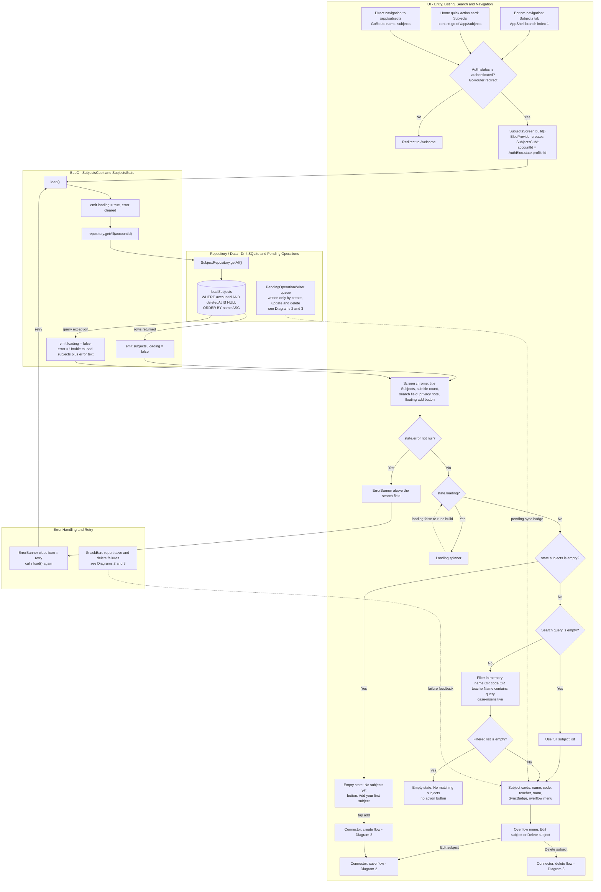
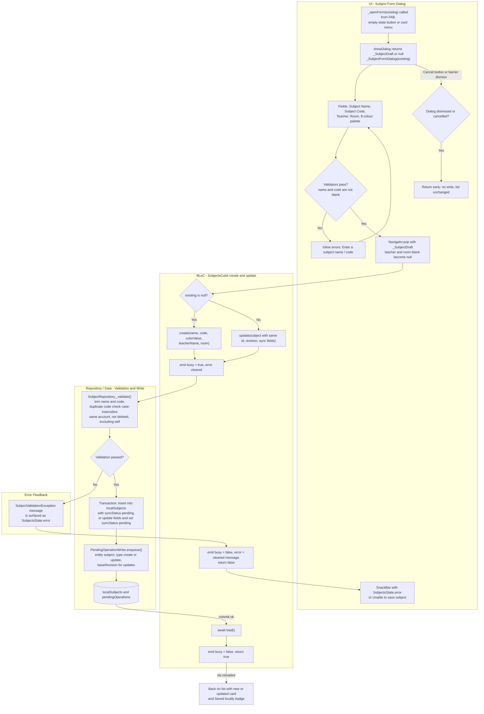
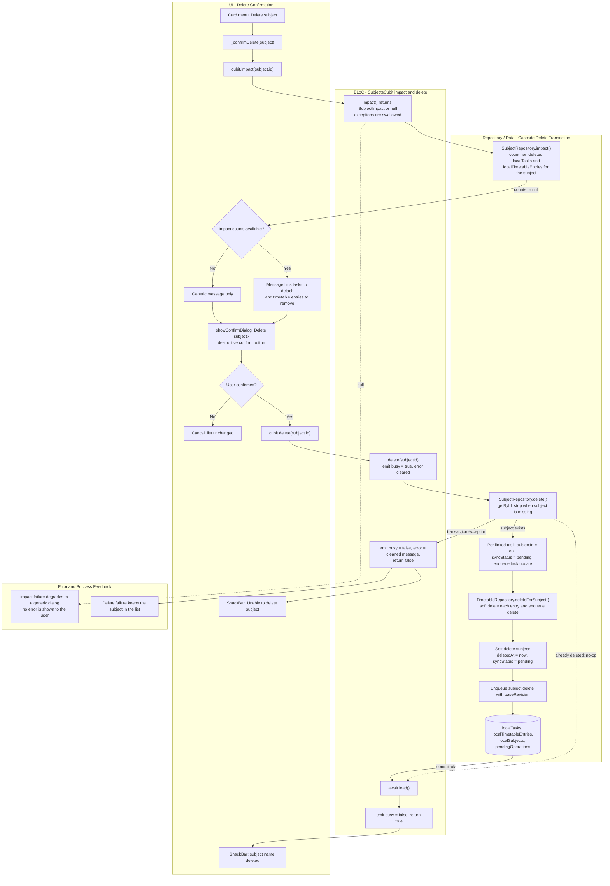

# MyCampus — Subjects Module Flowchart

> **Source of truth:** this document was produced by reading the code in
> `C:\hsu\mycampus` (project **MyCampus**, Flutter + `flutter_bloc` + `go_router` +
> Drift/SQLite). Every diagram below reflects **implemented code only**. No
> application source file was modified; only this Markdown file was created.
>
> Where something is *inferred* rather than literally verifiable in code, it is
> called out explicitly (see **Not Implemented / Needs Confirmation**).

---

## 1. Module at a glance (confirmed from source)

| Aspect | Actual implementation |
| --- | --- |
| Route | `/app/subjects` (GoRoute name `subjects`), shell branch index **1** |
| Screen | `SubjectsScreen` (`StatelessWidget`) wrapping `_SubjectsView` (`StatefulWidget`) |
| State management | **Cubit**, not a classic Bloc: `SubjectsCubit` + `SubjectsState`. **There are no BLoC event classes for this module.** |
| Repository | `SubjectRepository` (constructor: `LocalDatabase`, `PendingOperationWriter`, `TimetableRepository`) |
| Data sources | Drift/SQLite tables `localSubjects`, `localTasks` (detach), `localTimetableEntries` (cascade), `pendingOperations` (sync queue) |
| Backend / API | **No direct HTTP/Supabase call in this module.** Writes go to SQLite + the pending-operation queue. The app runs with `OfflineCloudGateway`, so queued operations stay pending (README "Local-only mode"). |
| Supported user flows | List, client-side search, create, edit, delete (with impact preview), retry via error banner |
| Detail screen | **None** — the list card itself is the detail view (name, code, teacher, room, sync badge) |
| Roles | **No role branch in this module.** Students and teachers use the same screen; data is scoped by `accountId` |
| Validation | Name + code required; **code must be unique per account** (case-insensitive); teacher/room optional |
| Delete semantics | Soft delete (`deletedAt`) + detach linked tasks to General Tasks + remove timetable entries, all in one transaction |

---

## 2. Reading the diagrams

- Rectangles are widgets/actions, diamonds are decisions, cylinders are SQLite storage.
- Decision branches are labelled **Yes / No**.
- Mermaid renders these diagrams declaratively; arrows show data/control flow, not wall-clock order.
- Diagram 1 covers entry, listing, search and navigation. Diagram 2 details create/edit. Diagram 3 details delete.

---

## 3. Diagram 1 — Entry, loading, listing, search and navigation

---

## 4. Diagram 2 — Create / Edit subject flow

---

## 5. Diagram 3 — Delete subject flow (impact preview and cascade)

---

## 6. Step-by-step flow explanation

### 6.1 Entry points and authentication

1. **Bottom navigation (primary entry).** `AppShell` renders a shared five-item
   navigation bar. The `Subjects` destination is `branch: 1`, which maps to
   `/app/subjects` inside `StatefulShellRoute.indexedStack`.
2. **Home quick action.** The dashboard's `Subjects` card calls
   `context.go('/app/subjects')`, which switches the shell to branch 1.
3. **Direct route / deep link.** Navigating to `/app/subjects` goes through the
   router. The global `redirect` requires `AuthStatus.authenticated`; otherwise
   the user is sent to `/welcome`. There is **no per-role guard** for subjects.

### 6.2 Screen creation and initial load

4. `SubjectsScreen.build()` reads `AuthBloc.state.profile.id`, constructs
   `SubjectsCubit(repository: SubjectRepository, accountId: profile.id)` and
   immediately calls `load()` inside `BlocProvider.create`.
5. `SubjectsState` starts as `loading: true` with an empty list, so the first
   frame shows the header, search field and a centered spinner.
6. `load()` emits `loading = true` with the error cleared, then calls
   `SubjectRepository.getAll(accountId)`. The query filters
   `deletedAt IS NULL` for that account and sorts by `name ASC`.
7. On success the cubit emits the list with `loading = false`; the ListView
   rebuilds and either renders cards or an empty state.
8. On failure (database exception) the cubit emits `loading = false` and
   `error: 'Unable to load subjects: …'`. The screen shows a red `ErrorBanner`
   above the search field. **The banner's close icon is wired to `load()`** —
   dismissing it doubles as a retry.

### 6.3 Listing, counting and search

9. The subtitle shows `Build your semester one subject at a time` when there are
   no subjects, otherwise `N subject(s) this semester` using the **unfiltered**
   count.
10. Typing in the search field only triggers a local `setState`; there is no
    repository call and no debounce. Filtering is case-insensitive `contains`
    across **name**, **code** and **teacherName** (the room field is not
    searched).
11. If the account has subjects but the filter matches none, the screen shows
    `No matching subjects` with no action button. If the account has no subjects
    at all, it shows `No subjects yet` plus an `Add your first subject` button.
12. Each card displays the subject colour, name, code, optional teacher and room,
    and a `SyncBadge`. Pending rows show `Saved locally`; a `synced` row renders
    nothing.

### 6.4 Create and edit

13. Both flows start at `_openForm(Subject? existing)` from the floating action
    button, the empty-state button, or the card menu.
14. `_SubjectFormDialog` opens with name, code, teacher, room and an 8-swatch
    colour palette (first palette colour is the default; an existing subject's
    colour is preselected). Name is autofocused; the code field uses
    `TextCapitalization.characters`.
15. `_submit()` runs the `Form` validators. Name and code are required; failure
    keeps the dialog open with inline messages. Success pops the dialog with a
    `_SubjectDraft`; teacher/room are trimmed and blank values become `null`.
16. `_openForm` then calls `cubit.create(...)` (new) or `cubit.update(Subject)`
    (existing id, existing revision/sync fields preserved) and shows a SnackBar
    with the cubit error if it returns `false`. **There is no success SnackBar
    for create/edit** — the reloaded list is the feedback.
17. The cubit emits `busy = true`, calls the repository, then reloads. The
    repository `_validate`s name/code and rejects a duplicate code
    (case-insensitive, same account, not deleted, excluding itself on update).
    A valid write inserts/updates `localSubjects` with `syncStatus = pending`
    and enqueues a `subject` `create`/`update` operation in the same transaction.

### 6.5 Delete

18. `Delete subject` from the card menu calls `impact()` first, which counts
    linked non-deleted tasks and timetable entries and builds the confirmation
    text (pluralised). If `impact()` throws, the cubit returns `null` and the
    dialog falls back to a generic warning.
19. `showConfirmDialog` uses `destructive: true` (red confirm button). Cancelling
    leaves the list untouched.
20. On confirm, `delete()` runs: the subject is re-read (`getById`), every linked
    task is detached (`subjectId = null`, queued as a task `update`), timetable
    entries are soft-deleted and queued, the subject is soft-deleted
    (`deletedAt = now`) and a subject `delete` operation is queued — all inside
    one local transaction. A missing/already-deleted subject is a silent no-op.
21. The cubit reloads the list and a `… deleted.` SnackBar appears on success, or
    a failure SnackBar on exception.

### 6.6 State feedback and sync interaction

22. Every mutation (create/update/delete) also triggers a Drift table update; the
    Home dashboard listens to `AppDependencies.dataChanges`, so subject edits are
    reflected there without a manual refresh. The Subjects screen itself only
    reloads on its own actions or on the error-banner retry.
23. Because no cloud gateway is configured, the enqueued operations remain
    `pending` by design (README), which is why cards normally show
    `Saved locally`.

### 6.7 Navigation back

24. Create/edit/delete dialogs pop back to the list with `Navigator.pop`.
25. There is no nested subject route, so there is nothing else to pop inside the
    branch. Switching tabs keeps this branch alive (`IndexedStack`), preserving
    list scroll position, search text and cubit state. Pressing system back while
    the Subjects tab is the active root was observed to exit the app on the
    emulator.
26. The global app-lock shield (`AppLockCubit`) can cover the screen after a
    lifecycle event; it is app-wide, not part of this module.

---

## 7. Mapping to actual source files, classes and functions

### 7.1 UI layer

| File | Symbol | Responsibility |
| --- | --- | --- |
| `lib/ui/screens/subjects/subjects_screen.dart` | `SubjectsScreen.build` (L11–26) | Reads `profile.id`, provides `SubjectsCubit`, calls `load()` |
| `lib/ui/screens/subjects/subjects_screen.dart` | `_SubjectsViewState._openForm` (L44–85) | Opens the form dialog, dispatches create/update, shows failure SnackBar |
| `lib/ui/screens/subjects/subjects_screen.dart` | `_SubjectsViewState._confirmDelete` (L87–132) | Fetches impact, builds confirmation text, calls delete, shows SnackBars |
| `lib/ui/screens/subjects/subjects_screen.dart` | `_SubjectsViewState.build` (L134–290) | Header, error banner, search, loading/empty/list branches, FAB |
| `lib/ui/screens/subjects/subjects_screen.dart` | `_SubjectCard` (L293–429) | Card rendering + `PopupMenuButton` edit/delete |
| `lib/ui/screens/subjects/subjects_screen.dart` | `_SubjectFormDialog` / `_SubjectFormDialogState._submit` (L514–781) | Form fields, colour palette, validation, draft pop |
| `lib/ui/screens/subjects/subjects_screen.dart` | `_SubjectDraft` (L499–512) | Immutable dialog result |
| `lib/ui/screens/subjects/subjects_screen.dart` | `_PrivacyNote` (L460–497) | Explains account privacy and delete side effects |
| `lib/ui/widgets/common.dart` | `ErrorBanner` (L177–237), `EmptyState` (L111–175), `SyncBadge` (L296–334), `showConfirmDialog` (L471–515), `showAppSnack` (L517–521) | Shared UI used by the module |
| `lib/ui/shell/app_shell.dart` | `_destinations` (L29–60), `Subjects` branch 1 (L37–41) | Bottom-nav and rail entry |
| `lib/ui/screens/home/home_screen.dart` | `_ShortcutRow` Subjects card (L629–634) | Home quick action → `/app/subjects` |
| `lib/ui/router/app_router.dart` | `GoRoute /app/subjects` (L107–115), `redirect` (L44–66) | Route and authentication gate |

### 7.2 BLoC layer

| File | Symbol | Responsibility |
| --- | --- | --- |
| `lib/logic/subjects/subjects_cubit.dart` | `SubjectsState` (L8–38) | `subjects`, `loading`, `busy`, `error` + `copyWith` |
| `lib/logic/subjects/subjects_cubit.dart` | `SubjectsCubit.load` (L47–60) | Sets loading, loads list, maps exception to `error` |
| `lib/logic/subjects/subjects_cubit.dart` | `SubjectsCubit.create` (L62–88) | Builds `Subject` with `IdService.newId()`, saves, reloads |
| `lib/logic/subjects/subjects_cubit.dart` | `SubjectsCubit.update` (L90–101) | Saves an edited subject, reloads |
| `lib/logic/subjects/subjects_cubit.dart` | `SubjectsCubit.impact` (L103–109) | Read-only helper; returns `null` on failure, emits no state |
| `lib/logic/subjects/subjects_cubit.dart` | `SubjectsCubit.delete` (L111–122) | Deletes, reloads, returns success flag |
| `lib/logic/subjects/subjects_cubit.dart` | `SubjectsCubit._clean` (L124–126) | Strips the `Exception: ` prefix from error text |

### 7.3 Repository / data layer

| File | Symbol | Responsibility |
| --- | --- | --- |
| `lib/repositories/subject_repository.dart` | `SubjectImpact` (L9–19) | `tasksToDetach`, `timetableEntriesToRemove`, `hasImpact` |
| `lib/repositories/subject_repository.dart` | `getAll` (L28–37) | Account-scoped, non-deleted, ordered by name |
| `lib/repositories/subject_repository.dart` | `getById` (L39–49) | Account-scoped single lookup used by delete |
| `lib/repositories/subject_repository.dart` | `create` (L51–81) | Validate, transaction insert, enqueue `create` |
| `lib/repositories/subject_repository.dart` | `update` (L83–115) | Validate, transaction update, enqueue `update` |
| `lib/repositories/subject_repository.dart` | `impact` (L118–150) | Counts linked tasks and timetable entries |
| `lib/repositories/subject_repository.dart` | `delete` (L154–220) | Detach tasks, delete timetable rows, soft delete, enqueue `delete` |
| `lib/repositories/subject_repository.dart` | `_validate` (L222–249) | Required name/code + duplicate code (case-insensitive) |
| `lib/repositories/subject_repository.dart` | `SubjectValidationException` (L268–275) | Message shown to the user via `SubjectsState.error` |
| `lib/repositories/pending_operation_writer.dart` | `enqueue` (L22–85) | Builds operation payload, fingerprint, dependency and queue row |
| `lib/repositories/timetable_repository.dart` | `deleteForSubject` (L147–161), `delete` (L116–143) | Soft-delete each subject timetable entry and enqueue |
| `lib/services/local_database.dart` | `LocalSubjects` (L39–56), `LocalTasks` (L58–80), `LocalTimetableEntries` (L82–95), `PendingOperations` (L209–229) | Drift tables and columns |
| `lib/services/app_dependencies.dart` | `SubjectRepository` wiring (L104–106), DI field (L60) | Composition root |
| `lib/models/subject.dart` | `Subject`, `toJson`, `fromJson` | Domain model used in queue payloads |
| `lib/services/id_service.dart` | `IdService.newId()` (used at `subjects_cubit.dart` L72) | Subject id generation |
| `lib/constants/app_colors.dart` | `subjectPalette` (L45–54) | Eight selectable colours, default `0xFF6236F5` |

### 7.4 State contract

| State field | Initial value | Set by |
| --- | --- | --- |
| `subjects` | `const []` | `load()` success; cleared only on dispose |
| `loading` | `true` | `load()` start/end |
| `busy` | `false` | create/update/delete start/end — **not read by the screen** |
| `error` | `null` | load failure, write failure; cleared on next load or write attempt |

---

## 8. Confirmed behaviour vs. explicit gaps

**Confirmed (verified in code and/or on the Android emulator):** listing,
account scoping, search across name/code/teacher, create/edit dialog with
required name+code, unique-code enforcement, colour palette, delete impact
preview, cascade delete (tasks detached, timetable rows removed), soft delete,
offline queue writes, error banner retry, and the empty/loading/no-match states.
The module was also exercised end-to-end on the emulator (`/app/subjects`
renders, add/edit/delete dialogs work, no overflow or runtime errors observed).

---

## 9. Not Implemented / Needs Confirmation

### 9.1 Confirmed absent (not found in the Subjects module)

1. **No dedicated subject details screen or route** (no `/app/subjects/:id`).
   The card is the only detail surface; there is no tap-through.
2. **No enrollment / join / invite flow** for subjects (classroom joining is a
   separate Classrooms module feature, not Subjects).
3. **No subject "content"** — no notes, attachments, syllabus, materials,
   grades, attendance or progress views.
4. **No archive/restore or purge UI** for soft-deleted subjects; `deletedAt` is
   only filtered out by queries.
5. **No sorting, grouping, filtering or pagination controls** — the list is
   always name-ascending from SQL and search is the only filter.
6. **No bulk actions**, no swipe-to-delete, no multi-select.
7. **No success SnackBar for create/edit** (only failures are announced).
8. **No direct backend/API call** in `SubjectRepository`; no Supabase client
   usage here. Cloud state only changes through the shared sync engine, which
   is out of scope for this module and unexercised without a configured gateway.
9. **No teacher/student-specific subject behaviour** in this module (no role
   branch, no "My Subjects" variant, no permission checks beyond account scope).
10. **No name-duplicate validation** (only code uniqueness is enforced).
11. **No debounced search, no search history, no room-field search.**
12. **No pull-to-refresh** and no explicit refresh button; the only reload
    triggers are screen creation, the error-banner retry, and the cubit's own
    post-write reloads.

### 9.2 Needs confirmation (code is ambiguous or product intent is unclear)

1. **`SubjectsState.busy` is never rendered.** Save/delete operations do not
   disable the FAB, the menu or the dialog, so a second action can be started
   while a write is in flight. Confirm whether a busy indicator/guard was
   intended.
2. **Delete impact is advisory only.** Deleting is allowed even when tasks will
   be detached and timetable rows removed; confirm whether the SRS expects a
   block or an extra acknowledgement in those cases.
3. **Sync badge labels depend on a configured gateway.** Locally every subject
   stays `pending` ("Saved locally"). The `synced`, `failed` and `conflict`
   presentations exist in `SyncBadge` but cannot be produced by this module in
   local-only mode.
4. **Error text for load failures embeds the raw exception** (`$error`), while
   write failures are cleaned of the `Exception: ` prefix. Confirm the intended
   user-facing copy.
5. **Delete is a silent no-op when the subject is already gone** (for example,
   stale UI after another device sync) and still reports success. Confirm if a
   "not found" message is expected.
6. **Search counts**: the header count uses all subjects, not the filtered set.
   Confirm this is the intended UX.
7. **Back navigation** was observed to exit the app from the Subjects tab
   (branch root). Confirm this matches the expected Android back behaviour.
8. **No dedicated widget tests** exist for the Subjects screen; only the shared
   responsive-layout tests and analyzer cover the module.
